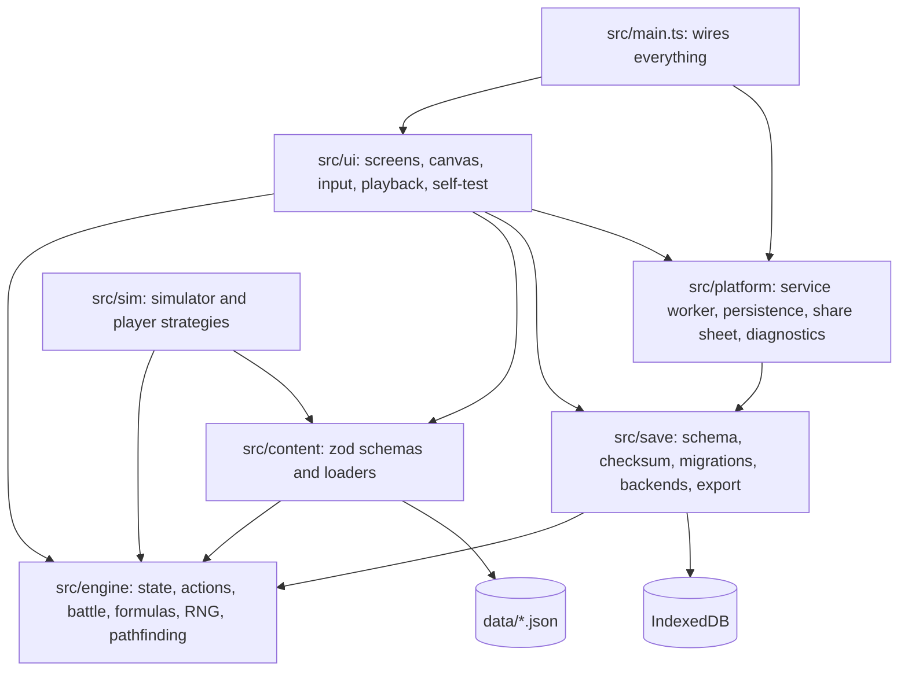
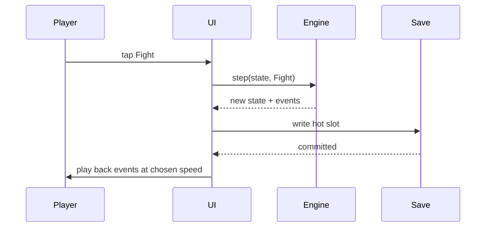

# Steadfast: Architecture

Written 2026-10-12 for the Phase 2 gate. Nothing described here is built yet: Phase 3a builds the platform parts, Phase 3b the game. Design is in `docs/GDD.md`, build rules in `CLAUDE.md`, state in `docs/STATUS.md`. The game ships as "Farther Still"; "Steadfast" is the codename.

## 1. Principles

1. **The engine is the game.** Every rule lives in pure, deterministic TypeScript that runs the same in the browser and in Node. The UI and the simulator are two clients of it.
2. **One state object, changed only by actions.** Nothing mutates game state except the engine's `step` function.
3. **Save before show.** A result is in storage before any of it is animated.
4. **Never overwrite what could not be read.** A save the app cannot use is kept, not replaced.
5. **Content is data.** Code holds formulas; `data/` holds every number and name.
6. **Platform before game.** Saves, install, offline and updates are proven with a dummy state in Phase 3a, before any game rule exists.

## 2. Modules



| Module | May import | Must not import | Runs in |
|---|---|---|---|
| `src/engine/` | Nothing outside itself, and no npm package | Everything else | Browser and Node |
| `src/content/` | Engine types and pure functions, zod | UI, save, platform | Browser and Node |
| `src/save/` | Engine types and `hash`, zod, idb | UI, sim | Browser; Node in tests with a fake IndexedDB |
| `src/platform/` | Save (the database handle only) | Engine, UI, sim | Browser |
| `src/ui/` | All of the above | Sim | Browser |
| `src/sim/` | Engine, content, Node APIs | UI, save, platform | Node |
| `src/main.ts` | UI and platform | Sim | Browser |

- ESLint's `no-restricted-imports` enforces the table, one override per folder. The engine also has its own `tsconfig.json` without the DOM library, so a DOM type there is a compile error.
- Test files (`*.test.ts`) may import Vitest. That is the only exception to the engine's "no npm package" rule.
- Golden replay tests need content as well as the engine, so they live in `tests/`, not in `src/engine/`.

## 3. Folder layout

```text
steadfast/
  CLAUDE.md
  index.html
  vite.config.ts
  eslint.config.js
  tsconfig.json                app: ui, save, platform, content
  .githooks/pre-commit         runs `npm run check`
  .github/workflows/ci.yml     one workflow: check and build, then deploy from main
  data/
    balance.json               every balance number in the GDD (systems; Michael reviews it)
    content-spec.json          expected counts for the current phase (structure; not sealed)
    ids.lock.json              every content ID ever shipped, with its kind (opaque; not sealed)
    zones.json                 sealed content from here down
    enemies.json
    items.json
    strings.en.json            every display name, place name and line of content text
    maps/z01.json ...          one tile grid per zone
  docs/
    KICKOFF.md  GDD.md  ARCHITECTURE.md  STATUS.md
    sealed/                    spoilers; hidden in diffs
  public/
    manifest.webmanifest  icons/
  scripts/
    check-content.ts           the GDD 7.9 checks
    check-repo.ts              reference/ untracked, token patterns, content names in unsealed text, ID lock and fixtures against the previous commit
    check-dist.ts              the built app: media, external URLs, reference-game title, CSP, manifest and phone rules
    check-prose.ts             hard-wrapped markdown
    build-refnames.ts          local only; hashes names from reference/
  src/
    engine/                    section 5
      math/  rng.ts  hash.ts   the only engine files allowed their own number literals
    content/                   section 6
    save/                      section 7
    ui/                        section 8
    platform/                  section 9
    sim/                       section 10
    main.ts
  tests/
    fixtures/saves/v1.json ... one frozen slot record per save version
    golden/                    golden replays and the test that runs them
    refnames.hashes.json       hashed reference-game names
    refnames.test.ts
  reference/                   private, gitignored
```

## 4. State

One plain, JSON-safe object. Its two halves are the game rows of the reset ledger in GDD 2.5.

```ts
type GameState = {
  profile: {                      // persists across runs
    items: Record<ItemId, number>;          // copies owned
    loadouts: Loadout[];                    // up to 5; each has a name and its slots
    activeLoadout: number;
    loadoutSlotsBought: number;
    claimedBosses: EnemyId[];
    gems: number;
    waypointsVisited: WaypointId[];
    waypointsUnlocked: WaypointId[];
    bestiary: Record<EnemyId, { seen: boolean; timesBeaten: number }>;
    strongestEverBeaten: number;
    secretsFound: SecretId[];
    autoAssign: { unlocked: boolean; on: boolean; split: StatSplit };
    hintsShown: HintId[];
    counters: { runsStarted: number; bestLevel: number };
  };
  run: {                          // replaced by NewRun
    seed: number;
    battleCount: number;
    spawnCount: number;
    xp: number;
    pointsSpent: StatPoints;
    growthPointsEarned: number;
    gold: number;
    energySpent: number;
    energyPaidBack: number;
    bossesBeaten: EnemyId[];
    strongestBeaten: number;
    lastEnemy: EnemyId | null;              // the Hero screen's bracketed figures use it
    salvageUsed: boolean;
    position: { zone: ZoneId; x: number; y: number };
    spawns: Record<SpawnId, { marked: MarkKind | null }>;
    stashesCollected: SecretId[];
    tallies: RunTallies;
  };
};
```

Derived, never stored, so that two copies of one fact cannot disagree:

- **Level**, from `xp` (GDD 5.1).
- **Unspent stat points**: points earned from level and Growth, less `pointsSpent`.
- **Remaining energy**, by the rule in GDD 2.2.
- **Drops found** for a bestiary entry: a drop counts as found once the player owns a copy of that item. A copy that came from Salvage counts, which is intended, since Salvage only offers that enemy's missed drops.
- **Doors**: open if the key item is owned.

Three ledger rows are not game state and the engine never sees them: settings, export tracking and the run-duration log. They are the `app` half of the save payload (section 7.1), versioned and migrated with the game half.

## 5. Engine

### 5.1 Public functions

| Function | Purpose |
|---|---|
| `step(state, action, content)` | Returns `{ state, events }` or `{ rejected: reason }`. The only way game state changes |
| `resolveBattle(hero, enemy, seed, balance, options)` | GDD section 3. Returns the outcome, summary numbers and, if asked, the event log |
| `forecast(state, spawn, content)` | 1,000 trial battles on the forecast stream; returns win chance and limiting factor (GDD 3.5) |
| `deriveHero(state, content)` | Final stats from points, gear and Growth (GDD section 4) |
| `enemyStats(enemy, zone, balance)` | An enemy's stats from the GDD 5.4 formula. The content loader calls it; the formula stays in the engine |
| `findPath(state, content, from, to)` | Shortest route over known-walkable tiles (GDD 8.3) |
| `level(state, balance)`, `unspentPoints(...)`, `remainingEnergy(...)` | The derived values in section 4 |
| `repairRun(state, content)` | Brings a run in line with changed content. The UI calls it at startup (section 7.3) |
| `hash(text)` | The pure checksum used by saves, golden replays and the on-device self-test |

`step` never throws on a player action. An action that is not allowed, such as a fight the player cannot afford, comes back as `rejected` with a reason the UI can show.

### 5.2 Actions

| Action | Effect |
|---|---|
| `NewRun { seed }` | Replaces `run`. The seed comes from the caller: the UI draws it from the browser's random source, the simulator from its own seed |
| `Step { dx, dy }` | One tile in one of eight directions, if walkable. Tapped routes and steering are both sequences of these. May find a secret or visit a waypoint |
| `Travel { waypoint }` | Moves to an unlocked waypoint |
| `UnlockWaypoint { waypoint }` | Spends gems |
| `Fight { spawn }` | Resolves a battle and applies GDD 3.4 in order |
| `Allocate { points }` | Spends stat points; cannot be undone within a run |
| `SetAutoAssign { on, split }` | |
| `Equip { loadout, slot, item }`, `SwitchLoadout { index }`, `RenameLoadout { index, name }` | |
| `Buy { item }`, `BuyLoadoutSlot` | Spends gold |
| `Salvage { boost }` | GDD 7.4 |
| `CollectStash { secret }`, `MarkHintShown { hint }` | |

### 5.3 Events

`step` returns events for the UI to present: battle events (attack, miss, hit with damage and crit flag, dodge, reflect, regen, last stand, end), reward events (XP, levels, gold, drops, gems, Claim) and state notices (door opened, waypoint unlocked, secret found). The simulator asks `resolveBattle` not to build the battle log, which is most of the cost. A test confirms that the outcome is identical with the log on and off.

### 5.4 Randomness

- One 32-bit generator built only from integer operations (`Math.imul`, shifts, xor), so it is bit-identical everywhere. The algorithm is chosen in Phase 3a and frozen with test vectors.
- A roll is `uint32 ÷ 2^32`, which is exact.
- Seeds for separate streams come from an integer hash of `(run seed, stream name, counter)`. Streams: `battle` and `reward` by battle count, `forecast` by battle count, `spawn` by spawn count, `salvage` by run.
- Rolls are drawn in the order GDD 3.2 lists, one number per listed roll.

### 5.5 Arithmetic

- **Allowed:** `+ − × ÷`, comparisons, integer bit operations, and exactly these `Math` members: `sqrt`, `floor`, `ceil`, `trunc`, `min`, `max`, `abs`, `imul`. Lint works from this allowlist, so any other `Math` member is an error.
- **Also banned in the engine:** the `**` operator, `Date`, `performance`, `Intl`, `toLocaleString` and `localeCompare`.
- `log10` is the engine's own: it finds the decade by comparing against a table of exact powers of ten, then evaluates a fixed series on the remainder. It is used only when stats are derived, never per hit, and is tested against known values to a stated tolerance.
- `Math.sqrt` is used only for level, whose result is then corrected by exact comparison, so a last-digit difference between browsers could not change a level.
- **Number literals.** Engine formulas may contain only 0, 1, 2 and 100; every other number comes from `balance.json`. Three places are exempt because their constants are structure, not balance: `math/` (the powers-of-ten table, the series, and closed forms such as the level formula, whose 8 comes from solving a quadratic), `rng.ts` and `hash.ts`.

### 5.6 Allocation policies

The kickoff asks for stat allocation to be pluggable. One type, three sources, all feeding the same `Allocate` action:

```ts
type AllocationPolicy = (ctx: { unspent: number; spent: StatPoints; hero: HeroStats }) => StatPoints;
```

- **Manual:** a policy that returns what the player entered on the Hero screen.
- **Auto-assign:** the engine's own policy, which applies the saved percentage split after each win (GDD 8.2).
- **Simulator strategies:** any function of this type.

## 6. Content

| File | Holds | Sealed |
|---|---|---|
| `data/balance.json` | Every balance number in the GDD: sections 3, 4, 5 and 7, and the Auto-assign unlock level | No |
| `data/content-spec.json` | Expected counts for the current phase, so the count check passes on the slice and again on full v1 | No |
| `data/ids.lock.json` | Every ID ever shipped and its kind | No |
| `data/zones.json` | Level band, coefficient key, waypoint, reference loadout, run start position | Yes |
| `data/enemies.json` | ID, zone, family, level, role, modifiers, tags, traits, drops, boss and gate flags | Yes |
| `data/items.json` | ID, kind (weapon, an armor slot, accessory, or key), item level, lines, effects, copy cap, shop price factor | Yes |
| `data/maps/zNN.json` | Tile grid, spawn points, doors, exits to other zones, waypoints, Salvage sites, stashes, hidden tiles, place-name keys | Yes |
| `data/strings.en.json` | Display names, place names and content text, keyed by ID | Yes |

- **Loading.** `src/content/` parses each file with a zod schema at startup and in tests, then builds the engine's `Content` object: lookups by ID, and each enemy's stats from the engine's `enemyStats`. A file that fails its schema stops the app with an entry in the diagnostics log.
- **IDs.** Opaque and permanent: `z01`, `e001`, `i001`, `w01`, `s01`. The lock file records each ID's kind. The repo checks compare the lock with the previous commit: no entry may disappear or change kind, and every ID in the data must be in the lock. In the hook the previous commit is the last one; in CI it is the commit before the push, with history fetched, since work lands directly on `main`. The lock is not sealed, because IDs carry no content, so its diffs can be reviewed.
- **Names.** Only `strings.en.json` holds names, so a name can change without touching structure or saves.
- **Sealing.** `.gitattributes` hides every file under `data/` in diffs except `balance.json`, `content-spec.json` and `ids.lock.json`. Michael reviews `balance.json` because curves are systems.
- **Checks.** `scripts/check-content.ts` runs the list in GDD 7.9: every item obtainable, every lock's key reachable first, no dead ends, no hidden tile on the required path, reference loadouts within budget, counts matching `content-spec.json`. Its output names things by ID only, never by display name. The reference-name test is separate (section 11).

## 7. Save system

Implements the kickoff's save spec. Built and tested in Phase 3a with a dummy state.

### 7.1 Storage

One IndexedDB database named `farther-still`, namespaced so nothing else on the origin can collide with it.

| Store | Holds |
|---|---|
| `slots` | `hot`, and `checkpoint-0` to `checkpoint-4` |
| `quarantine` | Raw copies of records, each stored once, keyed by slot, `seq` and checksum. Two kinds: *kept* copies of records that were damaged, replaced by an import or set aside by the player, which are never removed automatically; and *routine* copies made before a migration, of which the newest 10 are held. A routine copy never pushes out a kept one. Included in exports |
| `device` | Facts about this install, not about the game: notices waiting to be shown, the last build seen. Not part of a save |
| `diagnostics` | A ring buffer of the last 200 errors |

A slot record is `{ slot, saveVersion, buildId, contentVersion, seq, writtenAt, payload: { game, app }, checksum }`.

- `game` is the `GameState` in section 4. `app` holds settings, export tracking and the run-duration log. Both halves are covered by the same version, migrations, checksum, export and import.
- `seq` rises by one on every write. The newest record is the one with the highest `seq`, never the latest clock time, because a phone's clock can change.
- `checksum` is the engine's `hash` over every other field of the record, serialized with sorted keys. It needs no WebCrypto, so saves also work on the plain-HTTP LAN dev server. The hash algorithm is frozen with test vectors in Phase 3a; changing it later would be a save migration.
- `buildId` is the git commit the build was made from. `contentVersion` is a hash of everything under `data/`, `balance.json` included. Both are computed by the build, never typed by hand, and say what wrote the record (section 7.3).

### 7.2 Writing

All writes go through one writer that handles them in order, one at a time.

| Trigger | What is written |
|---|---|
| Any accepted action, except a `Step` that only moves the hero | Hot slot, before the UI shows the result |
| A `Step` that only moves the hero | Nothing yet; the position goes out with the next write |
| Any change to the `app` half: a setting, a recorded export, a run-duration entry | Hot slot |
| Page hidden (`visibilitychange`) and `pagehide` | Hot slot, if anything is unsaved. At most that is a position |
| New run confirmed | A checkpoint, then the hot slot |

- **Written means committed.** The write is done when the IndexedDB transaction completes. Playback and the next input wait for that.
- **Checks on every write.** The state must pass the save schema and the safe-integer check (GDD 6.2). A state that fails is an engine bug: it is not written over the good hot slot, and the app stops on a screen that offers the last good save as a text code.
- **Checkpoints.** The checkpoint slot with the lowest `seq` is the one replaced. It is written only if the state also passes the invariant checks: every equipped item owned in that many copies, no negative count, every ID present in content, claimed and beaten bosses really bosses. If they fail, the checkpoint is skipped, a notice says so and suggests an export, and the failure goes in the diagnostics log. Play continues on the hot slot, and loading treats that record the same way (section 7.3), so it is never silently dropped later.
- **A write that fails** is retried once on a fresh database connection. A second failure shows a blocking notice with the current state as a text code.

### 7.3 Loading

1. Open the database and read every slot. If it cannot be opened or read, show the recovery screen and write nothing.
2. If the read worked and there are no records at all, this is a new install: start a new game.
3. Sort each record into one of four kinds. Before a record is migrated, its raw form is copied to quarantine.

| Kind | Meaning |
|---|---|
| Good | Checksum matches, it migrates, and it passes the schema and the invariants |
| Suspect | Intact, meaning checksum and schema are fine, but an invariant fails |
| Damaged | The checksum does not match, the schema fails, or its migration throws |
| Newer | Its `saveVersion` is higher than the app's |

4. Look at the record with the highest `seq` of all, whatever its kind.
   - **Good:** use it. If it is not the hot slot, a notice says the hot slot was missing.
   - **Damaged:** keep a copy in quarantine, show a fallback notice once, and apply this same step to the record with the next highest `seq`. If none is left, show the recovery screen.
   - **Suspect or newer:** show the recovery screen. Nothing is written until the player chooses.

The point of step 4 is that the app never quietly falls back past a record it could not use and then writes over it.

**Recovery screen.** It says what was found and offers: export everything as it is, raw; try again; use a suspect record anyway; use an older good record, listed with its run count and time; restore a record from quarantine; or start a new game. Any choice that will lead to a record being overwritten first puts a kept copy of it in quarantine. If a record is newer than the app, the screen says so and offers the update. Restoring from quarantine is also available in Settings, and goes through the same checks and confirmation as an import.

**Run repair.** At startup, after a record is chosen and before anything is drawn, the UI compares the record's `contentVersion` with the running build's. If they differ and a run is in progress, it calls the engine's `repairRun`: a position that is no longer walkable moves to the run start; spawn and boss IDs that no longer exist are dropped; and if more points are spent than the run has now earned, all of the run's points are returned unspent. `profile` is never altered. A notice says the game was updated mid-run.

### 7.4 Versions and migrations

- `SAVE_VERSION` is a whole number. `src/save/migrations/` holds one function per step, applied in order.
- **Fixtures.** The commit that introduces a save version also adds a fixture written by that version: a complete slot record with its checksum. A fixture is never edited afterwards, and the repo checks fail if an existing fixture differs from the previous commit.
- **Tests.** Every fixture loads and migrates. The current version's fixture also loads with no migration and serializes back to the same bytes, which freezes the hash and the serialization. The zod schema's inferred type must equal the engine's `GameState` at compile time. Schemas are strict, so an unknown field is an error, never silently dropped. A hash of the schema's shape fails the build if it changes while `SAVE_VERSION` does not.
- **The first two versions.** Phase 3a's dummy state is version 1 and will be on Michael's phone. Phase 3b's real state is version 2, reached by a migration that discards the dummy fields. That exercises the migration path for real before any progress depends on it.

### 7.5 Backends, export and import

```ts
interface SaveBackend {
  readAll(): Promise<SlotRecord[]>;
  write(record: SlotRecord): Promise<void>;
}
```

- `LocalBackend` is IndexedDB through `idb`. `CloudBackend` arrives in Phase 5 (GDD section 11) and backs up after each run; it is never the primary.
- **Export:** the newest valid record, the quarantine store and the diagnostics log, as a JSON file through the share sheet, and the record alone as a text code that can be copied. The text code is the fallback where file sharing is unreliable.
- **Import:** a file or a pasted code is checked the same way as a loaded record. The app then shows the two saves side by side (runs started, items owned, when written) and asks for confirmation. On yes, the current hot record is copied to quarantine and to a checkpoint, and the import is written as the new hot slot with the next `seq`.
- Settings shows days since the last export and the result of `navigator.storage.persist()`. After 10 runs or 7 days without an export, a reminder appears that does not block play.

### 7.6 The iPhone facts this is built around

From the kickoff's save spec:

- Safari and the installed Home Screen app do not share storage. A save made in one is invisible to the other, so the only way across is export and import.
- Deleting the Home Screen icon deletes the save. Export is the only protection until cloud backup exists.
- The installed app is exempt from Safari's seven-day storage eviction only in standalone display mode, so the display mode never changes.
- The install address is permanent once installed (section 12).

## 8. UI

- **No framework.** Each screen in GDD 8.2 is a module that renders DOM from state and sends actions. A small screen switcher holds which screen and sheet are open; there is no URL routing.
- **The loop.** Input becomes an action; `step` returns state and events; the writer commits; then the screen re-renders and the events are played back. While a write is pending, further input waits.



- **Map and battle views.** Canvas 2D, the map camera following the hero. Placeholder art is shapes and emoji until content expansion.
- **Input.** A press that moves less than a small distance is a tap: on a tile it requests `findPath` and plays the steps; on an enemy it does the same and opens the pre-fight sheet. A press that moves farther is steering: the direction from the press point picks one of eight directions and the UI sends `Step` actions while it is held. Either control can be turned off in Settings. The map canvas sets `touch-action: none` and disables text selection so a drag is never taken as a scroll.
- **Playback.** Battles are already resolved and saved. Playback walks the event log at 1×, 2× or 4×, or jumps to the end. Speed is a setting, not game state.
- **Numbers.** One formatter implements GDD 6.4 and is unit-tested. Affordability is always decided by the engine, never by formatted text.
- **Phone rules.** Portrait layout, safe-area insets, controls in the lower half, tap targets at least 44 points, nothing that depends on hover, and no pinch or double-tap zoom. iOS does not let an installed web app lock its orientation, so in landscape the game shows a "turn your phone" panel.
- **Labels.** System labels (GDD section 0) are in `src/ui/`. Content names come from `strings.en.json`.
- **Engine self-test.** A Settings action re-runs the golden replays on the device and compares their hashes with the ones baked in at build time (GDD 6.3). It lives in the UI because it needs the engine.

## 9. Platform

- **Guards.** On the plain-HTTP LAN dev server `navigator.storage`, `navigator.share`, `navigator.clipboard` and `navigator.serviceWorker` do not exist. Every use is feature-tested first.
- **Manifest.** Name "Farther Still", `display: standalone`, start URL and scope at the site root.
- **Service worker.** Precaches the whole build so the game runs offline. What an update does, stated as it really behaves:
  - While the app is open, a new version downloads in the background and waits. The app shows "update ready" in Settings and on the new-run sheet. Tapping it on the new-run sheet applies the update and starts the run on the new version. Nothing reloads during a battle or anywhere else on its own.
  - If the app is fully closed, by a force-quit or by iOS reclaiming it, the waiting version takes over at the next launch without a tap. A browser gives no way to prevent that. This is why each record carries `buildId` and `contentVersion`, and why loading can repair a run (section 7.3).
  - The app asks for an update check each time it returns to the foreground, so one that is only ever resumed still learns of new versions.
- **Persistence.** `navigator.storage.persist()` is requested at launch and its answer shown in Settings. Nothing relies on it.
- **Diagnostics.** `error` and `unhandledrejection` are written to the ring buffer. Settings can show it, and exports include it, because there is no Mac to attach Web Inspector to the phone.
- **Content security policy.** Added to the built page only, since the dev server needs looser rules: scripts and styles from the site itself, images from the site or inline data, nothing from anywhere else. So no third-party script, font or tracker can load. Phase 5 adds the one backup address.

## 10. Simulator

`npm run sim` runs the engine headless in Node. A simulated player is a set of policies: which enemy to fight next, how to allocate, what to equip, what to buy, when to use Salvage, when to start a new run. Phase 3b ships one simple strategy and reports level, zone reached and runs to breakthrough over 50 runs. Phase 4 adds configurable strategies, CSV output and a markdown summary against every row of GDD 5.9. Simulator output names content by ID only.

## 11. Tests and checks

| Check | Tool | Catches |
|---|---|---|
| Typecheck | `tsc`, three projects: the engine, the app, and the tools (simulator, scripts, tests, service worker) | DOM use in the engine; the save schema and `GameState` drifting apart |
| Lint | ESLint with typescript-eslint | Media and audio APIs anywhere; in the engine, any `Math` member off the allowlist, `**`, clock, random and locale APIs, cross-module imports, and any number literal other than 0, 1, 2 and 100 outside the three exempt files |
| Unit tests | Vitest | Each formula at its GDD calibration points; the number formatter; the reducer; battle outcome identical with the log on and off; save-before-show order, using a backend that delays its commit; the update controller reloading only from the new-run sheet's action; run repair leaving `profile` untouched and the run valid |
| Golden replays | Vitest, in `tests/golden/` | Any change to battle results: fixed seed and loadout must give the same event-log hash |
| Save fixtures | Vitest with a fake IndexedDB | A version that no longer loads; a schema change without a version bump; a change to the hash or serialization; the load path writing over a damaged, suspect or newer record; a routine quarantine copy pushing out a kept one |
| Pinned names | Vitest | A change to the database name or a store name |
| Content checks | `scripts/check-content.ts` | The GDD 7.9 list |
| Reference names | `tests/refnames.test.ts` against `tests/refnames.hashes.json` | A content display name equal to a reference-game name |
| Repo checks | `scripts/check-repo.ts` | Anything under `reference/` tracked by git; a token pattern in a tracked file; a content display name appearing in unsealed tracked text; an ID removed from the lock or changed in kind since the previous commit; an existing save fixture changed |
| Prose | `scripts/check-prose.ts` | Hard-wrapped markdown. `docs/KICKOFF.md` is excluded because it is stored verbatim |
| Build scan | `scripts/check-dist.ts` | In `dist/`: media elements or audio calls; external URLs; the reference game's title or developer name; a missing content security policy or viewport tag; a `:hover` rule; a built manifest whose display mode, start URL or scope is not the pinned value |
| Pre-commit | `.githooks/pre-commit` | Runs `npm run check` |
| On-device self-test | Settings | The phone's engine disagreeing with Node's |

- `npm run check` is typecheck, lint, tests, content checks, repo checks and the prose check. The hook and CI both run it, so nothing depends on the hook alone.
- CI then builds and runs the build scan.
- **How names are checked without publishing them.** `scripts/build-refnames.ts` runs locally against `reference/` and stores only salted hashes of normalized names. The test hashes each content display name the same way and looks it up, so CI needs neither the names nor `reference/`. The build scan looks only for the reference game's title and developer name, which are already public in `docs/KICKOFF.md`, so it holds them as plain strings.
- Repo checks read file contents directly, because sealed paths print as binary in diffs.
- The scan for content names in unsealed text matches whole names, case-sensitively, so a one-word name that is also an ordinary word does not fire on every use of the word. Any exception is listed in a sealed file.

## 12. Build and deploy

- **Toolchain.** Node 24 and npm 11 (what is installed on the dev machine), Vite, TypeScript, Vitest, ESLint.
- **Hook.** `git config core.hooksPath .githooks`, set by `npm install` through a `prepare` script. No hook library.
- **CI and deploy.** One workflow. The `check` job runs on every push, with full history fetched so the repo checks can see the previous commit: install, `npm run check`, build, `npm run check:dist`. The `deploy` job needs `check` to pass and runs only on `main`: it publishes the build to GitHub Pages.
- **Address.** A free GitHub organization gives the app its own origin (GDD section 11). The repo there must be named `<organization>.github.io` to be served at the site root. Proposed: `farther-still.github.io`. The name is locked at the first install, so Michael sets this up at the start of Phase 3a, with exact steps given then. If he decides against an organization, the app would be served from a path under his personal address: the Vite base, the manifest's start URL and scope would all change to that path, and the shared-origin problem in GDD section 11 would stand.
- **Testing on the laptop.** `npm run preview` serves the built app on localhost, which browsers treat as a secure context, so the service worker and the update flow can be tried before a deploy.
- **Testing on the phone.** `npm run dev -- --host` serves the LAN for layout checks only: plain HTTP is not a secure context, so there is no service worker there. Everything else is tested from the Pages address after Add to Home Screen.

## 13. Decisions and open points

Proposed at the Phase 2 gate. Architecture decisions are logged here; design decisions stay in the GDD.

| ID | Decision | Reason |
|---|---|---|
| A-01 | The engine is a reducer: `step(state, action, content)` | One path for the UI, the simulator and tests; replayable; nothing else can change state |
| A-02 | Level, unspent points, remaining energy and drops found are derived, not stored | Two stored copies of one fact can disagree after a crash or a migration |
| A-03 | The checksum is a pure TypeScript hash over the whole record, not WebCrypto | Works on the plain-HTTP LAN dev server and in Node; it detects corruption, it is not security |
| A-04 | The newest save is chosen by a sequence counter, not the clock | A phone's clock can jump |
| A-05 | Settings, export tracking and the run-duration log are the `app` half of the save payload, outside `GameState` | The engine has no business seeing them, but they must survive export, import and migration like the rest. GDD 2.5 carries a note |
| A-06 | A save that cannot be used is quarantined and the player is shown a recovery screen. The app never starts fresh over existing records by itself, never falls back past a suspect or newer record by itself, and never removes a kept quarantine copy by itself | One bad deploy must not be able to erase the only copy on the phone |
| A-07 | Updates follow the browser's real lifecycle: applied by a tap on the new-run sheet, or at a cold start. Records carry a build and content version, and a changed version repairs the run | A waiting update cannot be held back once the app is fully closed |
| A-08 | Display names live in one strings file; content files are hidden in diffs, but `balance.json`, `content-spec.json` and `ids.lock.json` are not | Names change without touching structure; spoilers stay sealed; systems and opaque IDs stay reviewable |
| A-09 | The hook is a plain script behind `core.hooksPath`, and every check it runs is also in CI | One less dependency; no check depends on a hook that can be skipped |
| A-10 | A content security policy on the built page | Enforces "no ads, no third parties" by machine. Not in the kickoff's stack list |
| A-11 | Four tools beyond the kickoff's stack list: typescript-eslint, a fake IndexedDB for tests, a TypeScript runner for the simulator, and a Vite PWA plugin | The first three are development-only. The fourth is gate question A1 |

To settle in Phase 3a, by testing on the phone or reading current documentation:

- which seeded generator and which hash, each frozen with test vectors;
- which major version of zod to pin;
- whether IndexedDB's strict durability option is available on the phone's Safari;
- whether sharing a file from the installed app works on the phone, or only the text code;
- whether the database connection survives the app being backgrounded, which the retry in section 7.2 is there for;
- the exact steps for creating the GitHub organization, to give Michael before the first deploy.
