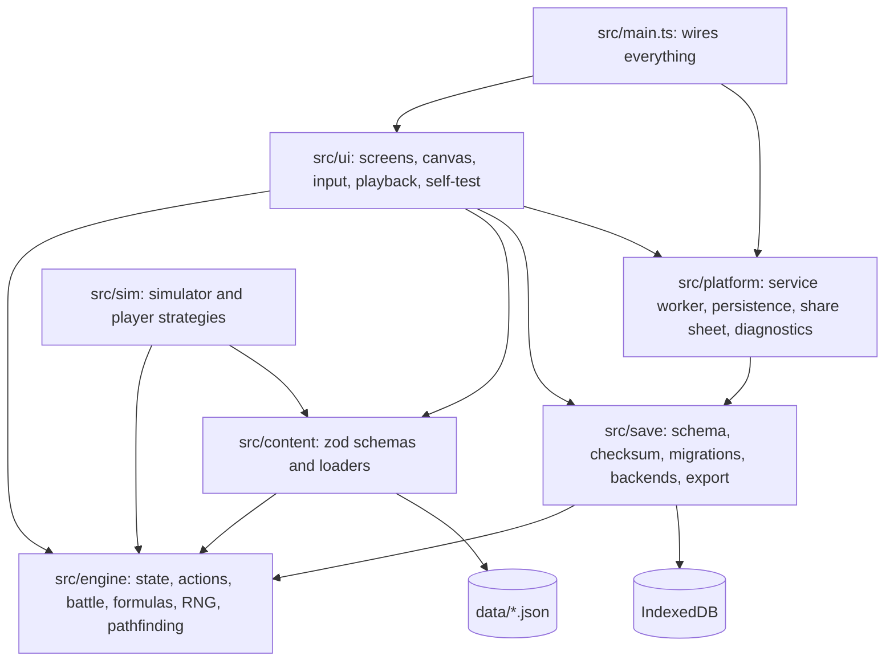
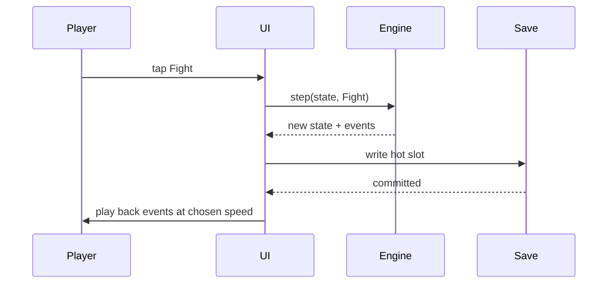

# Steadfast: Architecture

Written 2026-10-12 for the Phase 2 gate and updated the same day for the Phase 3a and Phase 3b gates. Phase 3a built the platform parts around a dummy state. Phase 3b replaced the dummy state with the game, as a vertical slice. Section 14 lists what exists and what is still to come. Design is in `docs/GDD.md`, build rules in `CLAUDE.md`, state in `docs/STATUS.md`. The game ships as "Farther Still"; "Steadfast" is the codename.

## 1. Principles

1. **The engine is the game.** Every rule lives in pure, deterministic TypeScript that runs the same in the browser and in Node. The UI and the simulator are two clients of it.
2. **One state object, changed only by actions.** Nothing mutates game state except the engine's `step` function.
3. **Save before show.** A result is in storage before any of it is animated.
4. **Never overwrite what could not be read.** A save the app cannot use is kept, not replaced.
5. **Content is data.** Code holds formulas; `data/` holds every number and name.
6. **Platform before game.** Saves, install, offline and updates are proven with a dummy state in Phase 3a, before any game rule exists.

## 2. Modules



| Module | May import | Must not import | Runs in |
|---|---|---|---|
| `src/engine/` | Nothing outside itself, and no npm package | Everything else | Browser and Node |
| `src/content/` | Engine types and pure functions, zod | UI, save, platform | Browser and Node |
| `src/save/` | Engine types and constants, `hash` and `canonicalJson`, zod, idb | UI, sim, platform, content | Browser; Node in tests with a fake IndexedDB |
| `src/platform/` | Save: the database handle and the store names only (`db`, `constants`) | Engine, UI, sim, content | Browser |
| `src/ui/` | All of the above | Sim | Browser |
| `src/sim/` | Engine, content, Node APIs | UI, save, platform | Node |
| `src/main.ts` | UI and platform | Sim | Browser |

- ESLint's `no-restricted-imports` enforces the table, one override per folder. The engine also has its own `tsconfig.json` (`src/engine/tsconfig.json`) without the DOM library, so a DOM type there is a compile error. `tests/enforcement.test.ts` lints and compiles a deliberate violation of each rule, so a rule that stops firing fails the build.
- Test files (`*.test.ts`) may import Vitest. That is the only exception to the engine's "no npm package" rule. Engine tests are type-checked in the tools project, so Vitest's types never enter the engine project.
- The invariant checks need to know which IDs exist. The save module takes the engine's `Content` as a parameter for that; it does not import `src/content/`.
- The engine's rule is stricter than a list of forbidden folders: a file in `src/engine/` may not import anything from outside that folder at all, by any relative path. That is what stops an engine file reading `data/balance.json` directly, past its schema.
- Dynamic `import()` is banned throughout `src/`, because its path is only known at run time and no boundary rule can follow it.
- Golden replay tests need content as well as the engine, so they live in `tests/`, not in `src/engine/`.
- Engine tests share one small made-up world, `src/engine/sample.fixture.ts`. A `*.fixture.ts` file is test support: it is left out of the engine and app projects, type-checked with the tools, and linted like a test, so it may hold any number. The save and UI tests use the same world through `tests/helpers.ts`.

## 3. Folder layout

```text
steadfast/
  CLAUDE.md
  index.html
  vite.config.ts               build, build ID, content version, content security policy, test settings
  eslint.config.js
  tsconfig.base.json           options shared by the four projects below
  tsconfig.json                app: ui, save, platform, content, main
  tsconfig.sw.json             the service worker, with the worker library and no DOM
  tsconfig.tools.json          tests, fixtures, the simulator, scripts and the Vite config
  .githooks/pre-commit         runs `npm run check`
  .githooks/commit-msg         refuses a commit message that holds a content name
  .github/workflows/ci.yml     one workflow: check and build, then deploy from main
  data/
    balance.json               every balance number in the GDD, with the zone table (systems; Michael reviews it)
    content-spec.json          expected counts for the current phase (structure; not sealed)
    ids.lock.json              every content ID ever shipped, with its kind (opaque; not sealed)
    zones.json                 sealed content from here down
    enemies.json
    items.json
    strings.en.json            every display name, place name and line of content text
    maps/z01.json ...          one tile grid per zone
    name-scan-exceptions.json  strings-file keys the name scan skips, each with a reason
  docs/
    KICKOFF.md  GDD.md  ARCHITECTURE.md  STATUS.md
    sealed/                    spoilers; hidden in diffs
  public/
    manifest.webmanifest  icons/
  scripts/
    lib.ts                     git plumbing and reporting shared by the checks
    check-repo.ts              reference/ untracked, token patterns, content names in unsealed text, ID lock and fixtures against the previous commit
    check-content.ts           the GDD 7.9 checks
    check-dist.ts              the built app: media, external URLs, reference-game title, CSP, manifest and phone rules
    check-prose.ts             hard-wrapped markdown
    refnames.ts                how a name is normalized and hashed, shared by the next file and its test
    build-refnames.ts          local only; hashes names from reference/
  src/
    engine/                    section 5
      tsconfig.json            the engine project: no DOM library
      types.ts                 IDs, the balance table, content definitions, derived figures
      state.ts                 GameState, a new game, a fresh run, the marked-enemy roll
      formulas.ts              every formula in GDD sections 2, 4, 5 and 7
      battle.ts  forecast.ts   combat resolution; the pre-fight forecast
      map.ts                   walkable tiles, single steps, pathfinding, the content index
      step.ts                  the reducer and run repair
      policies.ts              allocation policies
      math/  rng.ts  hash.ts   the only engine files allowed their own number literals
      sample.fixture.ts        the made-up world the tests share
    content/                   section 6: schemas.ts, bundle.ts (the files that ship), index.ts (the loader)
    save/                      section 7
      migrations/v1-to-v2.ts   one frozen file per version step
    ui/                        section 8
      app.ts  controller.ts    startup and the screen switcher; the save-before-show loop
      mapview.ts               the canvas map and its two controls
      fight.ts  salvage.ts     pre-fight sheet, playback and result sheet; the Salvage sheet
      screens.ts  gear.ts  settings.ts  sheets.ts  recovery.ts   the screens of GDD 8.2
      format.ts  labels.ts     the number formatter; every system label
      selftest.ts              the engine self-test and golden replays
    platform/                  section 9
    sim/                       section 10: player.ts, run.ts, report.ts, cli.ts
    main.ts
    env.d.ts                   the two build-time constants
  tests/
    helpers.ts                 a fresh fake IndexedDB per test, sample records, stores that fail on demand
    fake-dom.ts                a stand-in for the few DOM parts the UI uses, so startup and recovery wiring can be tested
    fixtures/saves/v1.json ... one frozen slot record per save version
    golden/                    golden values, the test that runs them, and the hash cross-check
    enforcement.test.ts        each lint ban and the engine's no-DOM compile, shown to fire
    checks.test.ts             each check script, shown to fire
    refnames.hashes.json       salted hashes of reference-game names
    refnames.test.ts
  reference/                   private, gitignored
```

## 4. State

One plain, JSON-safe object. Its two halves are the game rows of the reset ledger in GDD 2.5. This is save version 2, as built in Phase 3b.

```ts
type GameState = {
  profile: {                      // persists across runs
    items: Record<ItemId, number>;          // copies owned; keys are items too
    loadouts: Loadout[];                    // 2 to 5; each has a name and one cell per slot
    activeLoadout: number;
    claimedBosses: EnemyId[];
    gems: number;
    waypointsVisited: WaypointId[];
    waypointsUnlocked: WaypointId[];
    bestiary: Record<EnemyId, { timesBeaten: number }>;   // an entry means the enemy has been fought
    strongestEverBeaten: number;            // a level
    secretsFound: SecretId[];
    autoAssign: { unlocked: boolean; on: boolean; split: StatSplit };
    hintsShown: HintId[];
    counters: { runsStarted: number; bestLevel: number };
  };
  run: {                          // replaced by NewRun
    seed: number;
    battleCount: number;
    spawnCount: number;
    xp: number;
    pointsSpent: StatPoints;
    growthPointsEarned: number;
    gold: number;
    energySpent: number;
    energyPaidBack: number;
    bossesBeaten: EnemyId[];
    strongestBeaten: number;                // a level
    lastEnemy: EnemyId | null;              // the Hero screen's bracketed figures use it
    salvageUsed: boolean;
    position: { zone: ZoneId; x: number; y: number };
    marks: Record<SpawnId, { stat: 'xp' | 'drops' | 'gold'; percent: number }>;   // marked spawns only
    stashesCollected: SecretId[];
    tallies: { wins: number; losses: number; itemsGained: ItemId[]; claims: number; gemsGained: number };
  };
};

type Loadout = { name: string; slots: Record<SlotId, ItemId | null> };   // weapon, twelve armor types, acc1 to acc5
```

Derived, never stored, so that two copies of one fact cannot disagree:

- **Level**, from `xp` (GDD 5.1).
- **Unspent stat points**: points earned from level and Growth, less `pointsSpent`.
- **Remaining energy**, by the rule in GDD 2.2.
- **Drops found** for a bestiary entry: a drop counts as found once the player owns a copy of that item. A copy that came from Salvage counts, which is intended, since Salvage only offers that enemy's missed drops.
- **Doors**: open if the key item is owned.
- **Loadouts bought**: the list's length less the free ones.
- **Seen**: an enemy has been seen if it has a bestiary entry.

Three places where the built state is leaner than the Phase 2 sketch, each by the rule above (A-23): there is no `loadoutSlotsBought`, because the list's length says it; a bestiary entry has no `seen` flag, because no rule could ever write `false`; and `marks` holds only the spawns that carry a mark, so a spawn added by a content update needs nothing repaired.

Three ledger rows are not game state and the engine never sees them: settings, export tracking and the run-duration log. They are the `app` half of the save payload (section 7.1), versioned and migrated with the game half.

## 5. Engine

### 5.1 Public functions

| Function | Purpose |
|---|---|
| `step(state, action, content)` | Returns `{ state, events }` or `{ rejected: reason }`. The only way game state changes |
| `resolveBattle(hero, enemy, generator, balance, options)` | GDD section 3. Returns the outcome, summary numbers and, if asked, the event log. It takes a generator, not a seed, so the forecast can draw a thousand battles from one |
| `forecast(state, spawn, content)` and `forecastBattle(hero, enemy, seed, counter, balance)` | 1,000 trial battles on the forecast stream; returns win chance and limiting factor (GDD 3.5) |
| `deriveHero(state, content)` | Final stats from points, gear and Growth (GDD section 4). Takes an optional item list, which is how the Gear screen previews a change |
| `enemyStats(enemy, zone, balance)` | An enemy's stats from the GDD 5.4 formula. The content loader calls it; the formula stays in the engine |
| `findPath(state, content, from, to)`, `canStep`, `walkable` | Shortest route over known-walkable tiles; whether one step is allowed (GDD 8.3) |
| `level(state, balance)`, `unspentPoints(...)`, `remainingEnergy(...)` | The derived values in section 4 |
| `fightBlock(state, spawn, content)` | Why a fight cannot start, or null: the same test `step` applies, so the Fight button and the reducer cannot disagree |
| `salvagePool`, `salvageChance`, `salvageBands`, `shopPrice`, `loadoutPrice`, `dropsHeld` | What the Salvage, Items and pre-fight screens show, from the same functions `step` uses |
| `repairRun(state, content)` | Brings a run in line with changed content. The UI calls it at every load (section 7.3) |
| `indexContent(content)` | Builds the lookups by tile and by item. The content loader and the tests' made-up world both go through it |
| `hash(text)` | The pure checksum used by saves, golden replays and the on-device self-test: SHA-256 over the text's UTF-8 bytes, as 64 hex characters |
| `canonicalJson(value)` | The one serialization that gets hashed: keys sorted, no whitespace. Throws on a value JSON cannot hold exactly |

`step` never throws on a player action. An action that is not allowed, such as a fight the player cannot afford, comes back as `rejected` with a reason the UI can show. So does anything it does not know: an action type from a newer build, or something that is not an action at all.

### 5.2 Actions

| Action | Effect |
|---|---|
| `NewRun { seed }` | Replaces `run`. The seed comes from the caller: the UI draws it from the browser's random source, the simulator from its own seed |
| `Step { dx, dy }` | One tile in one of eight directions, if walkable. Tapped routes and steering are both sequences of these. May find a secret or cross into another zone |
| `Fight { spawn }` | Resolves a battle and applies GDD 3.4 in order. The hero must be beside the enemy |
| `Allocate { points }` | Spends stat points; cannot be undone within a run |
| `Equip { loadout, slot, item }`, `SwitchLoadout { index }`, `RenameLoadout { index, name }` | |
| `Buy { item }`, `BuyLoadoutSlot` | Spends gold |
| `Salvage { boost }` | GDD 7.4 |
| `CollectStash { secret }`, `MarkHintShown { hint }` | |

Not built in the slice, though the state has their fields: `Travel { waypoint }` and `UnlockWaypoint { waypoint }`, which arrive with Z3, and `SetAutoAssign { on, split }`, which arrives later in v1.

### 5.3 Events

`step` returns events for the UI to present. A fight gives a `Battle` event carrying the battle's log (round, miss, hit with damage and crit flag, extra turn, dodge, enemy hit, Last Stand, Reflect, regen on either side, end) and, on a win, a `Rewards` event: XP, level before and after, gold, drops, gems, whether the boss was claimed, energy charged, paid back and left, and the mark that was used up. Every other action gives one event: run started, moved, zone entered, secret found, stash collected, allocated, equipped, loadout switched, renamed or bought, item bought, salvaged, hint shown. The forecast asks `resolveBattle` not to build the log, which is most of the cost. A test confirms that the outcome is identical with the log on and off.

### 5.4 Randomness

- One 32-bit generator built only from integer operations (adds, shifts, xor), so it is bit-identical everywhere: sfc32, with 15 warm-up rounds (A-12). It is frozen by the vectors in `src/engine/rng.test.ts`.
- A roll is `uint32 ÷ 2^32`, which is exact.
- Seeds for separate streams come from an integer hash of `(run seed, stream name, counter)`: the first four words of `hash` over the text `seed:stream:counter`. Streams: `battle` and `reward` by battle count, `forecast` by battle count, `spawn` by spawn count, `salvage` by run.
- Rolls are drawn in the order GDD 3.2 lists, one number per listed roll. GDD 3.3 gives the order of the reward stream and of a marked-enemy roll.
- Hashing a seed is slow next to drawing a number, so a stream is hashed once and then drawn from. A forecast's thousand battles share one generator.

### 5.5 Arithmetic

- **Allowed:** `+ − × ÷`, comparisons, integer bit operations, and exactly these `Math` members: `sqrt`, `floor`, `ceil`, `trunc`, `min`, `max`, `abs`, `imul`. Lint works from this allowlist, so any other `Math` member is an error.
- **Also banned in the engine:** the `**` operator, `Date`, `performance`, `Intl`, `toLocaleString` and `localeCompare`.
- `log10` is the engine's own: it finds the decade by comparing against a table of exact powers of ten, then evaluates a fixed series on the remainder. It is used only when stats are derived, never per hit, and is tested against known values to a stated tolerance.
- `Math.sqrt` is used only for level, whose result is then corrected by exact comparison, so a last-digit difference between browsers could not change a level.
- **Number literals.** Engine formulas may contain only 0, 1, 2 and 100; every other number comes from `balance.json`. Three places are exempt because their constants are structure, not balance: `math/` (the powers-of-ten table, the series, and closed forms such as the level formula, whose 8 comes from solving a quadratic), `rng.ts` and `hash.ts`.

### 5.6 Allocation policies

The kickoff asks for stat allocation to be pluggable. One type, three sources, all feeding the same `Allocate` action:

```ts
type AllocationPolicy = (ctx: { unspent: number; spent: StatPoints; hero: HeroStats }) => StatPoints;
```

- **Manual:** `manualPolicy`, which returns what the player entered. The Hero screen sends each spend through it.
- **Auto-assign:** `splitPolicy`, the engine's own policy, which applies a percentage split (GDD 8.2). It is built and tested; the Auto-assign screen and the unlock arrive later in v1.
- **Simulator strategies:** any function of this type. The Phase 3b strategy uses `splitPolicy` with its own split.

## 6. Content

| File | Holds | Sealed |
|---|---|---|
| `data/balance.json` | Every balance number in the GDD: sections 3, 4, 5 and 7, and the Auto-assign unlock level. It includes the zone table of GDD 5.4 and 7.5 for all eight zones, level bands and all, because prices need the band of a level in a zone not yet built (A-24), and the pacing targets of GDD 5.9, which no rule reads and the simulator reports against | No |
| `data/content-spec.json` | Expected counts for the current phase, and which zones are built in full, so the count check passes on the slice and again on full v1 | No |
| `data/ids.lock.json` | Every ID ever shipped and its kind | No |
| `data/zones.json` | The run start position; for each zone, its row of the balance zone table and its reference loadout | Yes |
| `data/enemies.json` | ID, zone, family, level, role, modifiers, tags, traits, drops, boss and gate flags, and the one character drawn for it | Yes |
| `data/items.json` | ID, kind (weapon, an armor slot, accessory, or key), item level, lines, Resistance and Damage against tags, the Claim flag, copy cap, shop price factor | Yes |
| `data/maps/zNN.json` | Tile grid, spawn points, doors, exits to other zones, waypoints, Salvage sites, secrets (hidden tiles and stashes), place-name keys | Yes |
| `data/strings.en.json` | Display names, place names and content text, keyed by ID | Yes |
| `data/name-scan-exceptions.json` | Strings-file keys the repo's name scan skips, each with a reason. Empty so far | Yes |

- **Loading.** `src/content/` parses each file with a zod schema at startup and in tests, then builds the engine's `Content` object: lookups by ID, and each enemy's stats from the engine's `enemyStats`. A file that fails its schema stops the app with an entry in the diagnostics log.
- **IDs.** Opaque and permanent: `z01`, `e001`, `i001`, `s001`, `x01`, `w01`. The lock file records each ID's kind, which is finer than "item" or "enemy" on purpose: an item's kind is its slot, and a boss is its own kind. A save holds items in slots and bosses in its claimed list, and since the repo check refuses a change of kind, neither can change under a save (A-25). The repo checks compare the lock with the previous commit: no entry may disappear or change kind, and every ID in the data must be in the lock. In the hook the previous commit is the last one; in CI it is the commit before the push, with history fetched, since work lands directly on `main`. The lock is not sealed, because IDs carry no content, so its diffs can be reviewed.
- **Names.** Only `strings.en.json` holds names, so a name can change without touching structure or saves.
- **Sealing.** `.gitattributes` hides every file under `data/` in diffs except `balance.json`, `content-spec.json` and `ids.lock.json`. Michael reviews `balance.json` because curves are systems.
- **Checks.** `scripts/check-content.ts` runs the list in GDD 7.9: every item obtainable, every lock's key reachable first, no dead ends, no hidden tile on the required path, reference loadouts within budget, counts matching `content-spec.json`, the data matching the ID lock, and the handovers, secrets and Salvage sites the verifier found it missing. Its flood fill judges every step with the engine's own `canStep`, so the check cannot drift from the rules of movement. Its output names things by ID only, never by display name. The reference-name test is separate (section 11).
- **Lookups.** `indexContent` builds the tables by tile and by item, and makes every lookup table a bare one: an ordinary object answers to names such as `constructor`, so an ID of that spelling in a crafted save or action would otherwise look like known content.

## 7. Save system

Implements the kickoff's save spec. Built and tested in Phase 3a with a dummy state.

### 7.1 Storage

One IndexedDB database named `farther-still`, namespaced so nothing else on the origin can collide with it.

| Store | Holds |
|---|---|
| `slots` | `hot`, and `checkpoint-0` to `checkpoint-4` |
| `quarantine` | Raw copies of records, each stored once, keyed by slot, `seq` and a checksum of the raw copy itself, so two differently damaged copies of one record are both held. Two kinds: *kept* copies of records that were damaged, replaced by an import or set aside by the player, which are never removed automatically; and *routine* copies made before a migration, of which the newest 10 are held. A routine copy never pushes out a kept one. Included in exports |
| `device` | Facts about this install, not about the game: notices waiting to be shown, the last build seen, the map's zoom level. Not part of a save |
| `diagnostics` | A ring buffer of the last 200 errors |

A slot record is `{ slot, saveVersion, buildId, contentVersion, seq, writtenAt, payload: { game, app }, checksum }`.

- `game` is the `GameState` in section 4. `app` holds settings (playback speed, skip every battle, and each of the two movement controls), export tracking, the timing of the run in progress and the run-duration log: one entry per finished run, the newest 200, with the time actually played. Both halves are covered by the same version, migrations, checksum, export and import.
- `seq` rises by one on every write. The newest record is the one with the highest `seq`, never the latest clock time, because a phone's clock can change. The sequence carries on after the highest `seq` in storage, so the next write outranks every record there that could win a load, including one from a newer version that the player chose to go back past. One limit keeps damage from leaving the sequence where it cannot go on: a record the app could not use counts only if its `seq` is below 2^40, which one write every millisecond would take 35 years to reach. A usable record always counts, since the app must be able to follow its own writes. The schema caps `seq` below 2^52.
- `checksum` is the engine's `hash` over every other field of the record, serialized with sorted keys. It needs no WebCrypto, so saves also work on the plain-HTTP LAN dev server. The hash is SHA-256 written in plain TypeScript (A-12), frozen by the published test vectors and by the byte-exact fixture test; changing it later would be a save migration.
- `buildId` is the git commit the build was made from. `contentVersion` is the first 16 hex characters of a hash of everything under `data/`, `balance.json` included. Both are computed by the build, never typed by hand, and say what wrote the record (section 7.3).

### 7.2 Writing

All writes go through one writer that handles them in order, one at a time.

| Trigger | What is written |
|---|---|
| Any accepted action, except a `Step` that only moves the hero | Hot slot, before the UI shows the result |
| A `Step` that only moves the hero | Nothing yet; the position goes out with the next write |
| Any change to the `app` half: a setting, a recorded export, a run-duration entry | Hot slot |
| Page hidden (`visibilitychange`) and `pagehide` | Hot slot, if anything is unsaved. At most that is a position |
| New run confirmed | A checkpoint, then the hot slot |

- **Written means committed.** The write is done when the IndexedDB transaction completes. Playback and the next input wait for that.
- **Checks on every write.** The state must pass the save schema and the safe-integer check (GDD 6.2). A state that fails is an engine bug: it is not written over the good hot slot, and the app stops on a screen that offers the last good save as a text code.
- **Checkpoints.** The checkpoint slot with the lowest `seq` is the one replaced. A checkpoint slot holding a record the app could not use counts as empty, so it is replaced first; its copy is already in quarantine by then. It is written only if the state also passes the invariant checks: every item in a loadout owned in that many copies and of the kind its slot takes, no negative count, every ID in `profile` present in content, every claimed boss really a boss. The invariants cover `profile`, whose IDs are permanent, and the plain arithmetic of `run`. What a run says about content, such as its position, its marks and the bosses it has beaten, is not judged: content can change under a run in progress, and that is run repair's job (section 7.3), not a reason to refuse the save (A-26). If they fail, the checkpoint is skipped, a notice says so and suggests an export, and the failure goes in the diagnostics log. Play continues on the hot slot, and loading treats that record the same way (section 7.3), so it is never silently dropped later.
- **A write that fails** is retried once on a fresh database connection, and the retry is recorded in the diagnostics log. A second failure shows a blocking notice with the current state as a text code.
- **At startup** the hot slot is written once before play begins if it does not already hold the chosen record as it stands: after a fallback, after a migration, after a run repair, on a new install, and after any choice on the recovery screen.
- **Durability.** Slot and quarantine writes ask IndexedDB for strict durability. Settings shows what the last write reported.

### 7.3 Loading

1. Open the database and read every slot. If it cannot be opened or read, show the recovery screen and write nothing.
2. If the read worked and there are no records at all, this is a new install: start a new game.
3. Sort each record into one of four kinds, in memory. A record that needs migrating is migrated in memory too; its raw form is copied to quarantine before the first slot write, which is the earliest anything could replace it.

| Kind | Meaning |
|---|---|
| Good | Checksum matches, it migrates, and it passes the schema and the invariants |
| Suspect | Intact, meaning checksum and schema are fine, but an invariant fails |
| Damaged | The checksum does not match, the schema fails, its migration throws, or it sits under a slot other than the one it names |
| Newer | Its `saveVersion` is higher than the app's, and it has a `seq` this version can use. A record that claims a newer version without one is junk and counts as damaged |

4. Look at the record with the highest `seq` of all, whatever its kind.
   - **Good:** use it. If it is not the hot slot, a notice says the hot slot was missing.
   - **Damaged:** keep a copy in quarantine, show a fallback notice once, and apply this same step to the record with the next highest `seq`. If none is left, show the recovery screen. "Once" means when the copy is first made: a damaged record that stays in its slot is skipped silently at later launches.
   - **Suspect or newer:** show the recovery screen. Nothing is written until the player chooses.

A record whose `seq` cannot be read is treated as possibly the newest, so it is looked at first.

5. On the way to using a record, and before any slot is written, every record the app could not use gets a kept copy in quarantine, wherever it sits in the order, and every migrated record gets a routine one. If those copies cannot be made, the recovery screen is shown instead. On the way to the recovery screen nothing at all is written.

The point of steps 4 and 5 is that the app never quietly falls back past a record it could not use and then writes over it.

**Recovery screen.** It says what was found and offers: export everything as it is, raw; try again; use a suspect record anyway; use an older good record, listed with its run count and time; restore a record from quarantine; or start a new game. Any choice that will lead to a record being overwritten first puts a kept copy of it in quarantine. If a record is newer than the app, the screen says so and offers the update. When storage could not be read at all, the screen offers only the two choices that write nothing: export everything, and try again. Nothing is known about the slots at that point, so no choice that would write over them is offered. The same two choices are all that is offered if the app throws part-way through starting; that screen says so in its own words, since a save may already have been rewritten by then (its earlier copy kept), and "try again" reloads the page. Records are listed newest first.

**Leaving the recovery screen.** A choice that leads to play reads the slots again at that moment and sets aside what it is about to replace, working from what is in storage then, never from what was read when the screen opened. If the slots cannot be read or the copies cannot be made, nothing is changed and the screen says so (A-19). Restoring from quarantine is also available in Settings, and goes through the same checks and confirmation as an import.

**Run repair.** At startup, after a record is chosen and before anything is drawn, the UI calls the engine's `repairRun`: a position that cannot be stood on moves to the run start; IDs in the run that content no longer has are dropped (bosses beaten, marks, stashes, the last enemy, the run's item tally); and if more points are spent than the run has now earned, all of the run's points are returned unspent. `profile` is never altered. It is called on every load, whatever content the record says it was written with: it returns the same object when the run already fits, which costs nothing, and a migrated record always needs it (A-27). If it changed anything, or the record's `contentVersion` differs from the running build's, the state is written at once, so the record names the content its run now fits, and a notice says the game was updated mid-run. An imported or restored record goes through the same repair.

### 7.4 Versions and migrations

- `SAVE_VERSION` is a whole number. `src/save/migrations/` holds one function per step, applied in order.
- **The fields around the payload never change meaning.** `slot`, `saveVersion` and `seq` are read from a record before anything else is known about it, including by an older version of the app looking at a newer save. A later version may change the payload freely, by migration, but not these three.
- **Fixtures.** The commit that introduces a save version also adds a fixture written by that version: a complete slot record with its checksum. A fixture is never edited afterwards, and the repo checks fail if an existing fixture differs from the previous commit.
- **Tests.** Every fixture loads and migrates. The current version's fixture also loads with no migration and serializes back to the same bytes, which freezes the hash and the serialization. The zod schema's inferred type must equal the engine's `GameState` at compile time. Schemas are strict, so an unknown field is an error, never silently dropped. A hash of the schema's shape fails the build if it changes while `SAVE_VERSION` does not.
- **A migration is a pure function of the record.** No clock, no random source and no content, so a fixture always migrates to the same bytes. Each lives in its own frozen file and spells out the shape it produces in full, without calling the engine's `newGame`, which will keep changing.
- **The first two versions.** Phase 3a's dummy state is version 1 and is on Michael's phone. Phase 3b's real state is version 2. The migration discards every dummy field and gives a new game at run 1. It carries two things over: the old run's seed, and the time the record was last written, as the moment export tracking and the run timer start from. Export tracking starts again, since an export of the dummy save is not a backup of this game. A migration cannot know where the run start is, because that is content, so it leaves the hero on a position no map has and run repair moves it (A-27). That exercises the migration path for real before any progress depends on it.

### 7.5 Backends, export and import

```ts
interface SaveBackend {
  readAll(): Promise<unknown[]>;      // every slot record as stored; one may be damaged
  write(record: SlotRecord): Promise<void>;
}
```

- `LocalBackend` is IndexedDB through `idb`. `CloudBackend` arrives in Phase 5 (GDD section 11) and backs up after each run; it is never the primary.
- **Export:** the newest valid record, the quarantine store and the diagnostics log, as a JSON file through the share sheet, and the record alone as a text code that can be copied: `FS1.` followed by the record's serialization in base64. The text code is the fallback where file sharing is unreliable. Where there is no share sheet at all, as on the laptop, the file is downloaded.
- **Import:** a file or a pasted code is checked the same way as a loaded record. A damaged record, or one from a newer version, is refused. A suspect one is offered with its problems listed and a "replace anyway" confirmation, as on the recovery screen, because it is the save the app itself tells the player to export when a checkpoint is skipped. A raw export made from the recovery screen can be imported too: the newest good record in it is offered, or failing that the newest suspect one. The app then shows the two saves side by side (runs started, items owned, when written) and asks for confirmation. On yes, the current hot record is copied to quarantine and to a checkpoint, and the import is written as the new hot slot with the next `seq`.
- Settings shows days since the last export and the result of `navigator.storage.persist()`. After 10 runs or 7 days without an export, a reminder appears that does not block play. It names only what is overdue, and "Later" puts it off until the app is next started, no longer (GDD D-33).

### 7.6 The iPhone facts this is built around

From the kickoff's save spec:

- Safari and the installed Home Screen app do not share storage. A save made in one is invisible to the other, so the only way across is export and import.
- Deleting the Home Screen icon deletes the save. Export is the only protection until cloud backup exists.
- The installed app is exempt from Safari's seven-day storage eviction only in standalone display mode, so the display mode never changes.
- The install address is permanent once installed (section 12).

## 8. UI

- **No framework.** Each screen in GDD 8.2 is a module that renders DOM from state and sends actions. A small screen switcher holds which screen and sheet are open; there is no URL routing.
- **The loop.** Input becomes an action; `step` returns state and events; the writer commits; then the screen re-renders and the events are played back. While a write is pending, further input waits.



- **Map view.** Canvas 2D, the camera following the hero, at one of two zoom levels (GDD 8.3, D-32): near, nine tiles across, so that a tile is a 44-point tap target on the phone, and far, fourteen across, where a tile is 28 points. A button at the end of the loadout row switches between them, and the map is drawn again at once without dropping a walk in hand. Drawing and taps go through one viewport, so a tap lands on the tile drawn under the finger at either level. The level is kept in the `device` store and in no save; if it cannot be read the map opens near, and if it cannot be stored the map still changes. It keeps one canvas for as long as the game runs, and every other screen is rebuilt from state on each change. A caption is wider than its tile, so one on the outermost column in view is pulled in to stay on the canvas, by less and less as its tile slides off. Placeholder art is flat colours and one character per enemy until content expansion. A walk is timed by a timer and only drawn by animation frames, because a browser sends no frames to a page it is not painting and a walk must never wait on one.
- **Battle view.** DOM, not canvas: two life bars and a line of text need no canvas (A-28). Bar widths are set as classes, since the content security policy forbids inline styles.
- **Input.** A press that moves less than a small distance is a tap: on a tile it requests `findPath` and plays the steps; on an enemy it does the same and opens the pre-fight sheet. A press that moves farther is steering: the direction from the press point picks one of eight directions and the UI sends `Step` actions while it is held, sliding along walls. Steering straight into an enemy opens its pre-fight sheet. Either control can be turned off in Settings, but not both. The map canvas sets `touch-action: none` and disables text selection so a drag is never taken as a scroll. A tap on a wall does nothing, so tapping cannot be used to probe for a hidden path.
- **Playback.** Battles are already resolved and saved. Playback walks the event log at 1×, 2× or 4×, or jumps to the end, and paces itself so a whole battle takes about four seconds at 1× whatever its length. A setting skips every battle straight to its result. Speed and skip are settings, not game state.
- **Numbers.** One formatter implements GDD 6.4 and is unit-tested. Affordability is always decided by the engine, never by formatted text.
- **Phone rules.** Portrait layout, safe-area insets, controls in the lower half, tap targets at least 44 points except the map's tiles at far zoom, nothing that depends on hover, and no pinch or double-tap zoom. iOS does not let an installed web app lock its orientation, so in landscape the game shows a "turn your phone" panel.
- **A short page.** iOS can hand the installed app a page that ends above the bottom of the screen by the height of the status bar (A-32). At launch, on a resize and on coming back to the front, the app reads the screen height, the page height and the two safe-area insets, and sets `data-band-below` on the page's root. Every rule that keeps clear of the home bar does so through one custom property, `--safe-bottom`, which that attribute sets to zero, since the home bar is then below the page. Settings shows the four numbers.
- **Labels.** System labels (GDD section 0) are in `src/ui/`. Content names come from `strings.en.json`.
- **Engine self-test.** A Settings action re-runs the golden replays on the device and compares their hashes with the ones baked in at build time (GDD 6.3). It lives in the UI because it needs the engine. The expected values are `tests/golden/golden.json`, and the golden test runs the same function under Node. The list is the hash, the generator, square roots, the serialization, the engine's logarithm and level formula, 24 battles between a hero and an enemy that between them use every effect and trait (with the hero's derived stats and a battle that runs to the round limit), two runs of the real game played through the reducer, a milestone replay (a secret and its stash, a boss with its payback and handover, the way on past the gate, Salvage, a Claim with the tool, and a run fought until the energy is gone), and the forecast for every enemy. A replay matches its own golden value whatever it does, so a separate test checks that each replay still reaches the rules it is there for.

## 9. Platform

- **Guards.** On the plain-HTTP LAN dev server `navigator.storage`, `navigator.share`, `navigator.clipboard` and `navigator.serviceWorker` do not exist. Every use is feature-tested first.
- **Manifest.** Name "Farther Still", `display: standalone`, start URL and scope at the site root.
- **Service worker.** Precaches the whole build so the game runs offline. A Vite PWA plugin generates the list of files to cache on each build (A-11); the worker's logic is our own code. What an update does, stated as it really behaves:
  - While the app is open, a new version downloads in the background and waits. The app shows "update ready" in Settings and on the new-run sheet. Tapping it on the new-run sheet starts the run, saves it, then applies the update and reloads onto the new version. Nothing reloads during a battle or anywhere else on its own. The one other place an update can be applied is the recovery screen, where no game is loaded (A-16).
  - Each version keeps its own cache, named after its file list, and the old one is deleted only when the new version takes over. So the version still running keeps reading the files it was built with.
  - A version installs only if the page it fetched asks for files that are all in its own list. Just after a deploy the host can briefly serve the previous deploy's page; a worker that cached that page beside the new files would leave an app that cannot start. If the check fails, installing fails, the running version stays, and the browser tries again at the next check (A-21).
  - Every deploy is a new version, including one that changes only documents, because the build is stamped with the commit. So any push to `main` leads to an "update ready".
  - If the app is fully closed, by a force-quit or by iOS reclaiming it, the waiting version takes over at the next launch without a tap. A browser gives no way to prevent that. This is why each record carries `buildId` and `contentVersion`, and why loading can repair a run (section 7.3).
  - The app asks for an update check each time it returns to the foreground, so one that is only ever resumed still learns of new versions.
- **Persistence.** `navigator.storage.persist()` is requested at launch and its answer shown in Settings. Nothing relies on it.
- **Diagnostics.** `error` and `unhandledrejection` are written to the ring buffer. Settings can show it, and exports include it, because there is no Mac to attach Web Inspector to the phone.
- **Content security policy.** Added to the built page only, since the dev server needs looser rules: scripts and styles from the site itself, images from the site or inline data, nothing from anywhere else. So no third-party script, font or tracker can load. Phase 5 adds the one backup address. The policy also forbids inline scripts, inline styles and code built at run time, so the UI sets classes, never `style` attributes, and zod's run-time compiler is switched off. Anything the policy blocks is written to the diagnostics log.

## 10. Simulator

`npm run sim` runs the engine headless in Node. A simulated player is a set of policies: which enemy to fight next, how to allocate, what to equip, what to buy, when to use Salvage, when to start a new run. It plays through `step` and walks the map with `findPath`, so a gate it has not opened really is in its way.

Phase 3b ships one simple strategy: climb on the strongest enemy the forecast likes, turn to collecting drops once the hero has outgrown what it can beat, buy the dearest thing it can afford, put on whatever a dice-free measure of strength rates highest, try a boss at lower odds than a normal enemy since a loss is free, and put leftover gold into Salvage. `npm run sim -- --runs 50` plays 20 simulated players for 50 runs each (`--players`, `--seed` and `--detail` change that) and reports, against GDD 5.9: level, strongest enemy and zone by run; the run on which each gate boss first fell; wins per run; level against strongest enemy; runs with a persistent gain; wins needing more than three tries; and minutes per run from a model of walking time plus seconds per fight.

Phase 4 adds configurable strategies, CSV output and a markdown summary against every row of GDD 5.9. Simulator output names content by ID only.

## 11. Tests and checks

| Check | Tool | Catches |
|---|---|---|
| Typecheck | `tsc`, four projects: the engine, the app, the service worker, and the tools (simulator, scripts, tests) | DOM use in the engine; the save schema and `GameState` drifting apart |
| Lint | ESLint with typescript-eslint | Media and audio APIs anywhere; in the engine, any `Math` member off the allowlist, `**`, clock, random and locale APIs, cross-module imports, and any number literal other than 0, 1, 2 and 100 outside the three exempt files |
| Unit tests | Vitest | Each formula at its GDD calibration points; the number formatter; the reducer; battle outcome identical with the log on and off; save-before-show order, using a backend that delays its commit; the update controller reloading only after an explicit apply, and never on a controller change nobody asked for; the service worker, run in a stand-in scope, waiting until it is asked and refusing to install with a mismatched page; run repair leaving `profile` untouched and the run valid; the short-page reading at the phone's own numbers, and a style rule that keeps clear of the home bar by any route but `--safe-bottom` (A-32) |
| Golden replays | Vitest, in `tests/golden/` | Any change to battle results: fixed seed and loadout must give the same event-log hash. The same list runs on the phone as the self-test |
| Save fixtures | Vitest with a fake IndexedDB | A version that no longer loads; a schema change without a version bump; a change to the hash or serialization; the load path writing over a damaged, suspect or newer record; a routine quarantine copy pushing out a kept one |
| Pinned names | Vitest | A change to the database name or a store name |
| Enforcement | Vitest, in `tests/enforcement.test.ts` and `tests/checks.test.ts` | A lint ban, the engine's no-DOM compile or a check script that has stopped firing: each is run against a deliberate violation |
| Content checks | `scripts/check-content.ts` | The GDD 7.9 list |
| Reference names | `tests/refnames.test.ts` against `tests/refnames.hashes.json` | A content display name equal to a reference-game name |
| Repo checks | `scripts/check-repo.ts` | Anything under `reference/` tracked by git; a token pattern in a tracked file; a content display name appearing in unsealed tracked text or in a commit message; an ID removed from the lock or changed in kind since the previous commit; an existing save fixture changed |
| Prose | `scripts/check-prose.ts` | Hard-wrapped markdown. `docs/KICKOFF.md` is excluded because it is stored verbatim |
| Build scan | `scripts/check-dist.ts` | In `dist/`: media elements, audio calls, the bare media tag names or media files; external URLs; the reference game's title or developer name in any spacing; a content security policy or viewport tag that is not exactly the pinned one; a `:hover` rule; a source map; a built manifest whose display mode, start URL or scope is not the pinned value, or that sets `display_override`; a service worker that calls `skipWaiting` anywhere but in answer to the page's message; a page that asks for a file the worker does not precache |
| Pre-commit | `.githooks/pre-commit` | Runs `npm run check` |
| Commit message | `.githooks/commit-msg` | A content display name in the message |
| On-device self-test | Settings | The phone's engine disagreeing with Node's |

- `npm run check` is typecheck, lint, tests, content checks, repo checks and the prose check. The hook and CI both run it, so nothing depends on the hook alone.
- CI then builds and runs the build scan.
- **How names are checked without publishing them.** `scripts/build-refnames.ts` runs locally against `reference/` and stores only salted hashes of normalized names. The test hashes each content display name the same way and looks it up, so CI needs neither the names nor `reference/`. The build scan looks only for the reference game's title and developer name, which are already public in `docs/KICKOFF.md`, so it holds them as plain strings.
- Repo checks read file contents directly, because sealed paths print as binary in diffs.
- The scan for content names in unsealed text matches a whole name in any case, with a plural ending, and with spaces or hyphens between its words. A name that is also an ordinary word the unsealed text uses is exempted in a sealed file, `data/name-scan-exceptions.json`, by strings-file key and with a reason; an exception that is stale or has no reason is itself a finding. The list is empty. The same scan runs over commit messages: a `commit-msg` hook refuses one that holds a content name, and the repo check reads the messages of the commits since the previous one, so CI catches what a skipped hook did not. A finding gives the name's number, never the name.
- The reference-name list holds 1,170 salted hashes: every enemy, item and zone name in the developer's data files, the names in the enemy file's drop columns, and one made-up canary. The test looks the canary up under the file's salt, so a file whose salt and hashes no longer belong together fails instead of quietly matching nothing.
- The build scan's check for external URLs allows three kinds of URL-shaped text that nothing is loaded from, each listed with its source in `scripts/check-dist.ts`: XML namespaces, and two strings inside zod. Anything else fails.

## 12. Build and deploy

- **Toolchain.** Node 24 and npm 11 (what is installed on the dev machine), Vite 8, TypeScript 6.0, Vitest 4, ESLint 10 with typescript-eslint 8, zod 4, idb 8 (A-18).
- **Hook.** `git config core.hooksPath .githooks`, set by `npm install` through a `prepare` script. No hook library.
- **CI and deploy.** One workflow. The `check` job runs on every push, with full history fetched so the repo checks can see the previous commit, which the workflow passes in as `PREVIOUS_COMMIT`: install, `npm run check`, build, `npm run check:dist`. The `deploy` job needs `check` to pass and runs only on `main`: it publishes the build to GitHub Pages. The repo's Pages source must be set to "GitHub Actions".
- **Who pushes.** Claude pushes to `main` once `npm run check` and `npm run check:dist` pass and STATUS is current; CI still gates the deploy. Michael's ruling at the Phase 3a gate (question 1, answer a).
- **Document-only pushes** ship a new version like any other, and are left that way until it becomes a nuisance. Michael's ruling at the Phase 3a gate (question 2, answer a).
- **Build ID.** The build stamps itself with the git commit, plus `-dirty` for a local build with uncommitted changes. `FS_BUILD_ID` overrides it, so that two local builds of one commit can be told apart when trying the update flow on localhost.
- **Address.** A free GitHub organization gives the app its own origin (GDD section 11). The repo there must be named `<organization>.github.io` to be served at the site root. Proposed: `farther-still.github.io`. The name is locked at the first install, so Michael sets this up at the start of Phase 3a, with exact steps given then. If he decides against an organization, the app would be served from a path under his personal address: the Vite base, the manifest's start URL and scope would all change to that path, and the shared-origin problem in GDD section 11 would stand.
- **Testing on the laptop.** `npm run preview` serves the built app on localhost, which browsers treat as a secure context, so the service worker and the update flow can be tried before a deploy.
- **Testing on the phone.** `npm run dev -- --host` serves the LAN for layout checks only: plain HTTP is not a secure context, so there is no service worker there. Everything else is tested from the Pages address after Add to Home Screen.

## 13. Decisions and open points

Proposed at the Phase 2 gate. Architecture decisions are logged here; design decisions stay in the GDD.

| ID | Decision | Reason |
|---|---|---|
| A-01 | The engine is a reducer: `step(state, action, content)` | One path for the UI, the simulator and tests; replayable; nothing else can change state |
| A-02 | Level, unspent points, remaining energy and drops found are derived, not stored | Two stored copies of one fact can disagree after a crash or a migration |
| A-03 | The checksum is a pure TypeScript hash over the whole record, not WebCrypto | Works on the plain-HTTP LAN dev server and in Node; it detects corruption, it is not security |
| A-04 | The newest save is chosen by a sequence counter, not the clock | A phone's clock can jump |
| A-05 | Settings, export tracking and the run-duration log are the `app` half of the save payload, outside `GameState` | The engine has no business seeing them, but they must survive export, import and migration like the rest. GDD 2.5 carries a note |
| A-06 | A save that cannot be used is quarantined and the player is shown a recovery screen. The app never starts fresh over existing records by itself, never falls back past a suspect or newer record by itself, and never removes a kept quarantine copy by itself | One bad deploy must not be able to erase the only copy on the phone |
| A-07 | Updates follow the browser's real lifecycle: applied by a tap on the new-run sheet, or at a cold start. Records carry a build and content version, and a changed version repairs the run | A waiting update cannot be held back once the app is fully closed |
| A-08 | Display names live in one strings file; content files are hidden in diffs, but `balance.json`, `content-spec.json` and `ids.lock.json` are not | Names change without touching structure; spoilers stay sealed; systems and opaque IDs stay reviewable |
| A-09 | The hook is a plain script behind `core.hooksPath`, and every check it runs is also in CI | One less dependency; no check depends on a hook that can be skipped |
| A-10 | A content security policy on the built page | Enforces "no ads, no third parties" by machine. Not in the kickoff's stack list |
| A-11 | Four tools beyond the kickoff's stack list: typescript-eslint, a fake IndexedDB for tests, a TypeScript runner for the simulator, and a Vite PWA plugin | The first three are development-only. Michael chose the plugin over a fully hand-written worker in gate question A1 (2026-10-12): it supplies the list of files to cache on each build, and the worker's update logic stays our own code |

Added in Phase 3a:

| ID | Decision | Reason |
|---|---|---|
| A-12 | The hash is SHA-256 over UTF-8, written in plain TypeScript. The generator is sfc32 seeded from the hash | SHA-256 has published test vectors and Node's own implementation to check against, so "frozen" can be proved, and it needs only 32-bit integer operations. sfc32 is small, well regarded statistically and also needs only integer operations. Speed is not a concern at save sizes |
| A-13 | zod 4, with its run-time compiler off | Version 4 has been the stable line since mid-2025 and describes a schema's shape without extra code, which the schema-hash test uses. The compiler is off because the content security policy forbids it, and so that Node and the phone run one parsing path |
| A-14 | Four TypeScript projects, not three: the service worker has its own | The worker needs the worker library and the tests need the DOM library; the two declare the same globals differently |
| A-15 | At load, every record the app cannot use gets a kept quarantine copy, not only the ones it fell back past. Quarantine keys use a checksum of the raw copy | A damaged checkpoint below a good hot slot would otherwise be rotated out with no copy. A record's own checksum field cannot tell two differently damaged copies apart |
| A-16 | An update can be applied from the recovery screen as well as the new-run sheet | A save from a newer version can only be opened by updating, and no game is loaded there to interrupt. Section 9 originally named the new-run sheet alone |
| A-17 | Phase 3a's dummy state is more than "a counter and a fake inventory". Beyond the bookkeeping any run needs (run count, seed, last roll), it adds one equipment slot, one aim and a step count | The equipment slot gives the checkpoint invariant something to fail. The aim is a run field that points at content, so run repair is real. The step count is a change that is not saved at once, so the write on hiding the app is real. All are discarded at version 2 |
| A-18 | TypeScript 6.0, Vitest 4 and version 1 of the PWA plugin, each one major version behind the newest | typescript-eslint does not yet support TypeScript 7. Vitest 5 and the plugin's 2.0 were weeks old on 2026-10-12. Stable over newest |

Added after the Phase 3a verifier pass, which found the first of these as a reproduced way to lose a save:

| ID | Decision | Reason |
|---|---|---|
| A-19 | A choice on the recovery screen reads the slots again before it writes, and after an unreadable start no writing choice is offered at all | The first build worked from what was read when the screen opened. After an unreadable start that was nothing, so restoring a set-aside save wrote the hot slot as save 1 over a save 57 it had never seen, with no copy kept |
| A-20 | A record the app could not use moves the write sequence only if its `seq` is below 2^40; a usable record always does. A checkpoint slot holding an unusable record counts as empty for rotation. The fallback notice is tied to the quarantine copy being new | A damaged record with a huge `seq` would otherwise stop every later write, sit in its slot for ever, and raise the same notice at every launch. Two earlier attempts were wrong: capping every `seq` made the app unable to read back its own writes near the cap, and trusting only checksum-verified records would have brought the recovery screen back at every launch after the player went back past a record from a newer version. The third verifier pass found the same loop for junk that merely claimed a newer version, which is why such a record now counts as damaged |
| A-21 | The service worker refuses to install unless the page it fetched matches its file list, and the build scan makes the same comparison | A page from the previous deploy cached beside the new files would not start, and the only fix on the phone would be deleting the app, which deletes the save |
| A-22 | A suspect save can be imported or restored after a "replace anyway" confirmation, and a raw export can be imported | Otherwise the export the app asks for when a checkpoint is skipped could not be read back, and the recovery screen's raw export could not be used at all |

Added in Phase 3b:

| ID | Decision | Reason |
|---|---|---|
| A-23 | The built state drops three things the Phase 2 sketch had: `loadoutSlotsBought`, the bestiary's `seen` flag, and an entry for every unmarked spawn | Each was a second copy of a fact the state already holds, which is what A-02 rules out |
| A-24 | The zone table, level bands included, is in `balance.json` for all eight zones; `zones.json` names a row | A price is `k × goldAt(level)`, and the third loadout is priced at a level in a zone the slice does not build. The table is GDD 5.4 and 7.5, which are not sealed |
| A-25 | The ID lock's kinds are fine-grained: an item's slot, and `boss` apart from `enemy`. A secret is only ever `secret` | The existing check that no ID changes kind then also guarantees that an item never changes slot and a boss never stops being one, which the save invariants depend on. What kind of secret an ID is stays sealed (GDD 7.5), and the lock is not a sealed file |
| A-26 | The save invariants judge `profile` and the arithmetic of `run`; the run's references to content are run repair's | Phase 2 listed "beaten bosses really bosses" as an invariant. An invariant failure sends the player to the recovery screen, and the load order checks invariants before it repairs, so a content update could have locked a run out that repair would have fixed |
| A-27 | Run repair is tried on every load, and the version 1 migration relies on it to place the hero | A pure migration cannot read content. Repairing only when `contentVersion` differs would have been true for every version 1 record, but by accident, not by rule |
| A-28 | Battle playback is DOM and paced to a fixed length; the map is the only canvas | Two bars and a line of text gain nothing from a canvas, and DOM text is sharp at any size. Section 8 originally said both views were canvas |
| A-29 | Content lookup tables are bare objects | `content.items['constructor']` is not `undefined` on an ordinary object, so a crafted import or action with such an ID passed as known content |
| A-30 | `*.fixture.ts` is a third kind of file beside source and test | The engine's tests need a shared world full of numbers, and an engine source file may hold none |
| A-31 | No DOM library was added for tests: `tests/fake-dom.ts` grew a canvas and pointer events | The Phase 3a question. The wiring tests need a tree, text, clicks and pointer positions, and nothing a real DOM would add |

Added in the Phase 3b review, from what Michael's phone showed:

| ID | Decision | Reason |
|---|---|---|
| A-32 | When the installed app's page is short of the screen by exactly the top inset, the app stops keeping room for the home bar and carries the tab bar's colour on below the page as a shadow. It does not try to lay anything out in the band | His iPhone 16 Pro gave a page 812 points high on a screen of 874 while still reporting a top inset of 62, leaving a dead band of 62 points under the tab bar. That is WebKit bug 301994, open since iOS 26.1 and reopened in August 2026, whose reports say the band cannot be reached from the page. Laying the app out into it would push the tab bar off the screen wherever that is true, and it cannot be tried without a Mac. Dropping the home-bar room is safe either way: the home bar lies inside the band. It wins back 34 of the 96 points being wasted. The shadow is paint only, so it adds nothing to scroll to, and it shows on the phone whether the band can be drawn in at all |

Settled in Phase 3a:

- The generator and the hash: A-12, frozen by `src/engine/rng.test.ts`, `src/engine/hash.test.ts` and the cross-check against Node in `tests/golden/golden.test.ts`.
- The zod version: A-13.
- The steps for creating the GitHub organization: given to Michael on 2026-10-12, before anything was deployed.

Settled on the phone, by Michael's Phase 3a acceptance run on his iPhone 16 Pro, 2026-10-12:

- IndexedDB's strict durability option is honoured in the installed app: Settings showed "Write durability: strict".
- `navigator.storage.persist()` was granted in the installed app. Nothing relies on it.
- The database connection survived the app being backgrounded and force-quit in that run: the diagnostics log held no `save-retry` entry. One run is not proof, so the retry in section 7.2 stays.
- The update flow behaved as section 9 describes: a deployed change waited as "update ready" while the app stayed open, and was applied from the new-run sheet. The diagnostics log's one entry was the app's own note that it was applying the waiting version.
- Sharing a file from the installed app works: the export sheet offered "Share the file", the file was saved on the phone, and it imported after the app had been deleted and reinstalled. The text code also copied into a note. So both export routes work on the phone, and the text code stays as the fallback it was designed to be.
- The phone's arithmetic matches Node's: the engine self-test read 9 of 9.

Nothing from the list of points to settle in Phase 3a is still open.

## 14. Phase 3b as built

What exists, so nobody has to infer it from the sections above, which describe the finished game.

- **Engine:** everything in section 5 except the three actions listed at the end of 5.2. The reducer handles a run from start to end: walking, fights, levels, allocation, loadouts, buying, Salvage, stashes, hidden tiles, zone exits, doors and a new run. The forecast, run repair, pathfinding and both allocation policies are built.
- **Content:** schemas and a loader for every file in section 6, and the slice: Z1 in full (10 enemies, 1 gate boss, 23 of the 25 items) and Z2's first two enemies with their two drops, behind the gate and before a sealed door. `data/dummy.json` is gone.
- **Save:** version 2, with the migration from version 1 and a fixture for each. The `app` half carries real settings and the run-duration log. The cloud backend is still Phase 5.
- **Platform:** unchanged from Phase 3a.
- **UI:** Map, pre-fight sheet, battle playback, result sheet, Hero, Gear, Items, Bestiary, Salvage, Run menu, New-run sheet, Settings, Recovery and the save-failed notice. Not built: the Waypoints screen and the Auto-assign screen.
- **Checks:** everything in section 11, including the three that Phase 3a deferred: `scripts/check-content.ts`, the reference-name test with `scripts/build-refnames.ts`, and the battle golden replays.
- **Simulator:** one strategy, as section 10 describes. Phase 4 expands it.
- **Tests:** the engine's tests were written from the GDD by a separate pass, not by the engine's author, so that they check the rules and not the code. That pass changed the engine in three places and left eight readings of the GDD as questions, which are settled in GDD 13.5 (D-30). The save tests and the UI wiring tests were each rewritten by a separate pass as well; the UI one fixed four display bugs.
