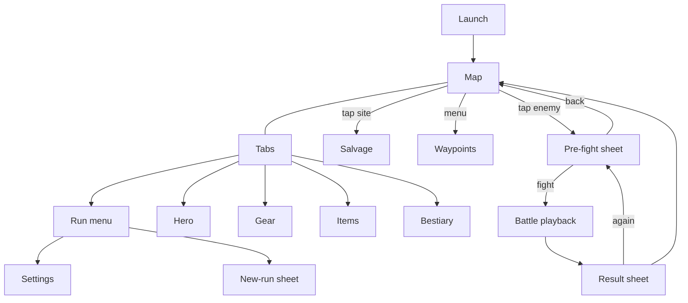

# Steadfast: Game Design Document

GDD v1.1. Written 2026-10-12 for the Phase 1 gate and approved by Michael the same day (section 13.4). Updated 2026-10-12 for the Phase 3b gate, when the vertical slice was built: what building it settled is in section 13.5, and each change is marked there.

## 0. How to read this

This file is the design truth (hard rule 6). `CLAUDE.md` holds build rules and `docs/STATUS.md` holds where the project is. "RH" is the reference game; its name, art and text never ship.

**Tags.** Tags mark claims about RH, as hard rule 1 requires.

- **Confirmed (Qn / Gn / notes):** Michael's interview answer, gate answer, or `reference/rh_notes.md`.
- **[WEB]:** public source, including the developer's published formulas and data files.
- **[GPT]:** claim from the ChatGPT recap, unconfirmed.
- **[ASSUMPTION]:** my default where nobody knows.
- **[OPEN]:** unknown, listed in section 12.
- **First-hand:** written as "Michael's screenshot", "Michael's turns" or "first-hand", usually with a chat number. It is what his own screenshot shows or his own message says. It outranks [WEB] and [GPT], but my reading of it is not confirmed until he confirms it.
- **C01–C31:** chat numbers in the private recap. They are cited and paraphrased here, never quoted.

**Starting values.** A number marked "starting value" is Steadfast's own, lives in `data/balance.json`, and will be tuned by the Phase 3b and Phase 4 simulators. What this gate approves is the shape of each formula and the pacing targets in section 5.9. Changing a starting value later is a balance change recorded in the decisions log, not a design change.

**Spoilers.** Under the spoiler policy (Q12, G2) this file shows structure only. Zones are Z1–Z8, elements are E1–E3 and enemy types are T1–T4. Their themes and every content name are in `docs/sealed/`, which Michael does not open. Git is set to hide that folder's contents in diffs.

**Terms.** Docs keep the working terms used since Phase 0. The app ships its own labels, because RH's labels are RH's text (hard rule 7). Code identifiers use the shipped labels.

| Working term in docs | Shipped label | Note |
|---|---|---|
| Energy | Energy | The kickoff's own word for the per-run battle budget |
| Archaeology | Salvage | Spend all gold for a chance at a drop you missed |
| Permanent-energy tool | (sealed name) | Its effect is labelled Claim |
| Item sets | Loadouts | Avoids the "set versus slot" confusion in C02 |
| Auto-allocator | Auto-assign | |
| Teleport points | Waypoints | |
| Bonus enemy | Marked enemy | Shown with a marker of our own, not RH's `*` |
| Double hit, double attack, double turn | Extra Hit, Extra Attack, Extra Turn | The kickoff's wording |
| Thorns | Reflect | |
| Survive deaths | Last Stand | |
| Per-level bonus | Growth | |
| Life, Damage, Defense, Dexterity, Luck | Unchanged | Plain genre words; renaming them would cost clarity |
| Bestiary, gems, gold | Unchanged | Plain genre words |

## 1. Design pillars

Each pillar names the feel to protect, the evidence, and what it obliges the design to do.

1. **Permanent progress changes what a run can do.** Evidence: C16, where starting energy went from 25 to 97 and Michael said it changed everything; Q13c. Obligation: permanent gains are felt on the very next run. They are starting energy, waypoints, loadout slots and kept gear.
2. **Every run buys something lasting.** Evidence: C24 (what is the point of pushing farther if the next run is no better), C06 and C21 (it feels like grinding). Obligation: gold always has a lasting use, and section 5.9 sets a target for how often a run must produce a persistent gain.
3. **You choose every fight.** Evidence: Q13a; [WEB] reviews praise planning over luck. Obligation: no random encounters, enemies stand on the map with their levels shown, and backing out before a fight is free. A fight that is joined costs its energy, win or lose (R-11).
4. **Loot is finite, fixed and visible.** Evidence: Q13b; notes #3. Obligation: no random stats, no rarity tiers, no set bonuses (G1). An enemy shows how many drops it still holds, and collecting has an end.
5. **The climb is quick; the decision is the point.** Evidence: C15, C23 and C26, where rebuilding the run was the cost that hurt, not the fight; C27 asked for faster battles; Q14. He also liked some of RH's grind, both farming drops and the climb, as long as it stops short of annoyance (section 13.4), so the aim is to cut waiting, not to cut repetition to nothing. Obligation: battle skip, tap-to-move and waypoints, with the run-time targets and the two ceilings in section 5.9.
6. **Level is not power.** Evidence: C24 and C30 (several times the boss's level and still losing), and C26 (the win came from swapping two accessories); Q13e. Obligation: builds and loadouts decide fights, enemy traits are visible before the fight, and the forecast names what is limiting you.
7. **Systems are signposted; content is discovered.** Evidence: C16 (he found the energy system about ten days in and was annoyed not to have known sooner); gates that looked like level walls but were knowledge gates (C15, C20, C22, C30); on the other side he liked finding a stash (C02) and a shortcut (C14). Obligation: every system is introduced in plain sight, the required path is never hidden, every lock says what opens it, and optional secrets stay secret.
8. **The game tells you what it knows before you spend.** Evidence: C26 (could not afford to test and test), C06 (worry about paying a run's gold for a low-level item); Q11. Obligation: the pre-fight forecast, the loss summary, the Salvage pool breakdown, and a one-line explanation behind every stat.
9. **A hand-built world you learn.** Evidence: Q13d, Q8; navigation friction in C03, C09, C15, C23 and C30; "how far along am I" asked in C01, C23 and C31. Obligation: hand-built maps, place names on the map that match what every other screen calls them, waypoints, and progress counters.
10. **Numbers that explode, legibly.** Evidence: the kickoff goal; C16. Obligation: the inflation curves in section 5, the number format in section 6, and an average shown for each multi-action layer.

## 2. Core loop and run structure

### 2.1 The loop

1. A run starts at level 1 with no gold, full energy, and everything that persists (section 2.5).
2. The player walks the map, or travels to an unlocked waypoint, and picks an enemy.
3. The pre-fight sheet shows the enemy, the energy cost, the forecast and the drops it still holds. The player fights or backs out.
4. The battle resolves instantly and is played back (section 3).
5. A fight charges its energy cost when it is joined, win or lose. A win pays XP, gold and drop rolls, and levels gained give stat points to spend. A loss pays nothing and takes nothing else.
6. Gold buys items from the shop at any time. Once per run, all remaining gold can go into Salvage.
7. Energy runs out. The player finishes spending and starts the next run, a little stronger.

### 2.2 Run rules

| Rule | Detail | Source |
|---|---|---|
| Energy cost | Each fight has a cost set by its zone (section 5.8). | Confirmed (Q2) |
| Every fight is charged | A fight costs its energy when it is joined, win or lose, and a retry is charged again. A boss pays nothing back for a loss. The rule is one switch in the balance table, on (D-34). | Ruling (R-11, 2026-10-13), and RH's rule: Confirmed by Michael on 2026-10-12 (R-01, section 13.6). Phases 3a and 3b charged only wins, on a misreading of Q2 (DV-10, withdrawn) |
| Boss payback | An unclaimed boss pays back its cost plus a surplus when beaten, once per run (sections 2.3 and 5.8). | Confirmed (notes #1, Q2) |
| Free actions | Walking, waypoint travel, buying and Salvage cost no energy. | Confirmed (Q2) |
| Affordability | A fight cannot be started if its cost exceeds remaining energy. | Confirmed (G1) |
| Chosen fights | Enemies stand on the map; nothing attacks the player. | Confirmed (Q13a) |
| Respawn | A normal enemy is back as soon as the player returns to the map, so fights chain on one spot. A boss is once per run. | Confirmed (Q9). RH's delay is "seconds"; Steadfast uses no timer at all. |
| Gate bosses | A gate boss blocks its path again every run. | Confirmed (Q5) |
| Keys | Keys are kept items; a door stays open for anyone holding its key. | Confirmed (Q5) |
| Waypoints | Bought with gems, kept forever, and they skip whatever lies before them. Travel is from the map menu, any time outside a battle. | Confirmed (Q4, Q5). Where RH lets you travel from is [OPEN]. |
| Full life | Every fight starts at full life; Last Stand charges reset each fight. | Confirmed (G1) |
| Stat points | Allocation is manual by default and cannot be taken back within a run. | Confirmed (notes #4, C26) |
| Zero energy | The player stays on the map and can still walk, buy and use Salvage. | Confirmed (Q7) |
| New run | Can be started at any time from the run menu. | Confirmed (G1) |

**Remaining energy** = starting energy + energy from equipped accessories + boss paybacks this run − energy spent this run, shown as 0 if that is negative. Starting energy = base + permanent energy claimed. A fight can start only if remaining energy covers its cost.

An energy accessory counts only while it is equipped, so taking it off lowers remaining energy at once. This needs no start-of-run ritual, but it has one trick in it: a player can fight in a combat loadout until energy is gone and put the energy accessories on for the last few fights, so the slot is only given up at the end of a run. That is accepted. Michael kept this rule in P4. RH's own rule is still [OPEN], because his answer covered both "yes" and "don't remember".

### 2.3 Permanent starting energy

Confirmed (Q6), a deviation from RH (DV-1).

- The first boss hands over the tool on its first defeat, guaranteed and in plain sight.
- The tool is a weapon that cuts Damage by 90% and has one effect, Claim. The cut is taken from final Damage, after Base and Mult, so no other gear buys it back (D-23).
- An unclaimed boss pays back its fight cost plus a surplus of 2 energy each run it is beaten.
- The first time a boss dies with the tool equipped, it is claimed: starting energy rises by 3 for good, at once, which also counts for the current run. That win pays no surplus, and from then on the boss refunds only its fight cost. Each boss can be claimed once, ever.
- So a Claim is worth 3 energy on every run that would have skipped that boss, and 1 on a run that would have beaten it anyway. Once a boss is claimed there is nothing to gain from beating it again, so nobody needs to tour old bosses, and a waypoint can skip them at no loss.
- Michael chose this rule in P3 over the alternative, in which a claimed boss keeps paying its surplus: every Claim would then be a full gain on every run, but beating every boss every run would stay the best play.
- The bestiary and the pre-fight sheet mark every boss as claimed or unclaimed.
- Because the tool guts damage, the player claims a boss after outgrowing it. That is the intended "come back and collect" decision. Reflect does not depend on the hero's Damage, so a Reflect build can claim earlier; section 5.6 limits how much Reflect v1 gear carries.
- What RH does after a claim is [OPEN]. One reviewer says the tool means bosses need not be beaten again each run [WEB], which is the rule above. Michael's notes #1 and #2 describe the payback and the permanent bonus separately and do not say. P3 did not settle it, because his answer covered both "no" and "don't remember".

### 2.4 Run end and new run

- At zero energy a banner says the run is spent and lists what is still unused: gold on hand and the Salvage attempt.
- "New run" asks for confirmation. The confirmation shows this run's level, strongest enemy beaten, new items, permanent energy gained, and the gold that will be lost.
- Confirming resets everything in the "resets" half of the ledger and writes a checkpoint save of the new run's first moment (kickoff save spec), then the main save. So a checkpoint is always a clean place to return to: everything kept, and a run not yet begun.

### 2.5 Reset ledger

This table drives the save schema: the left group is the `run` object, the right group is the `profile` object. The split was approved in Q5.

| Resets every run (`run`) | Persists (`profile`) |
|---|---|
| Level and XP | Items owned, with copy counts |
| Stat points, spent and unspent | Loadouts (contents, active one, slots bought) |
| Growth gains from gear (section 4) | Permanent energy: the set of bosses claimed |
| Gold | Gems |
| Energy spent and boss paybacks received | Waypoints visited and unlocked |
| Bosses beaten this run | Keys (they are items) |
| Strongest enemy beaten this run, and the last enemy fought | Bestiary: enemies seen, times beaten, drops found |
| The Salvage attempt | Strongest enemy ever beaten |
| Hero position | Secrets discovered on the map |
| Run seed, battle counter, spawn counter | Auto-assign: unlocked flag, on or off, saved split |
| Marked-enemy rolls and stashes collected | Lifetime counters and the run-duration log |
| This run's tallies for the new-run sheet | Settings, save version, export tracking |
| | First-time explanations already shown |

Notes:

- Full scope adds two persistent entries from the Q5 ledger: the journal and the sixth accessory slot.
- The run-duration log exists only to measure section 5.9's time targets during playtests. No mechanic reads it (hard rule 3).
- The cloud backup's key, and what the app remembers about the backup, are not in the save at all. They are facts about the install, like the map's zoom level, and are lost with the app (D-42, section 11).
- Three rows on the right are kept in the save but outside the game state the engine sees: settings, export tracking and the run-duration log. They form the `app` half of the save payload and are versioned, migrated, exported and imported with the rest (`docs/ARCHITECTURE.md` section 7.1).
- Unspent stat points and "drops found" are derived, not stored: unspent points from level, Growth and points spent; a drop counts as found once a copy of that item is owned.
- The run seed is drawn by the UI when a run starts and stored in `run`. The engine never reads a clock or a random source of its own.
- One profile only. RH has three save files [WEB]; Steadfast's extra save slots exist for safety, not for parallel playthroughs.

## 3. Combat resolution

A battle is a pure function of the hero's final stats, the enemy record and a seed. It returns win or loss plus an event log. The UI replays the log; the simulator calls the same function (kickoff stack).

### 3.1 Quantities

| Quantity | Formula | Source |
|---|---|---|
| Enemy rating `T` | `enemy level + 100` | [WEB] published |
| Hit chance | `1 − 0.10 × (T ÷ Accuracy)²`, held between 5% and 100% | 90% at `Accuracy = T` is [WEB]; the square fits one screenshot; the curve is [OPEN] in RH |
| Dodge chance | With `q = Evasion ÷ T`: `0.10 × q` below 1, else `0.10 + 0.26 × log10(q)`, capped at 80% | 10% at `q = 1` and the 80% cap are [WEB]; 0.26 fits two screenshots to within 2 points |
| Defense | Share of a hit removed = `defender's Defense ÷ (defender's Defense + attacker's Damage)` | [WEB] published; verified against two screenshots to within 1 point |
| Hero hit | `Damage × Damage ÷ (Damage + enemy Defense)` | Follows from the row above |
| Crit | Multiplies the hit by Crit Damage | Order relative to defense is [OPEN] in RH |
| Tag bonus | `1 + (sum of the hero's damage bonuses against tags this enemy has) ÷ 100` | Mechanic [WEB]; summing is Steadfast's rule |
| Enemy damage reduction | Multiplies everything the enemy takes by `1 − reduction` | [WEB]; shown separately from Defense, as in RH's screens |
| Enemy hit | `E × E ÷ (E + hero Defense)`, where `E` is enemy Damage | Same Defense rule |
| Resistance | Multiplies an enemy's damage by `100 ÷ (100 + R)`, where `R` is the sum of the hero's Resistances to every tag that enemy carries, never below 0 | [WEB] published: 100 halves, 200 removes two thirds. Summing across tags is Steadfast's rule |
| Reflect | The enemy takes `E × Reflect%`, before the hero's Defense and ignoring the enemy's Defense | [WEB]. Steadfast applies the enemy's damage reduction to it; RH is [OPEN] |

Each damage or healing amount is worked out as one product and rounded down once, at the end. A hit that lands does at least 1. Accuracy and Evasion are never below 1.

### 3.2 Order of a round

The hero acts first (Confirmed, G1).

1. **Hero turn.**
   1. From round 2 on, Life Regen heals the hero.
   2. Roll Extra Attack: the hero makes 1 or 2 attacks.
   3. For each attack, roll to hit. A miss ends that attack.
   4. On a hit, roll Extra Hit: the attack lands 1 or 2 hits.
   5. For each hit, roll crit and apply the damage. If the enemy's life reaches 0, the hero wins at once.
   6. Roll Extra Turn once. On success the hero repeats steps 2–5 one more time, with no second regen and no further Extra Turn.
2. **Enemy turn.**
   1. If the enemy has regeneration, it heals.
   2. The enemy makes 1 attack, plus a second if its double-attack roll succeeds, plus a third if its triple-attack roll then succeeds.
   3. For each attack, roll the hero's dodge. A dodged attack does nothing and triggers no Reflect.
   4. Otherwise the hero takes the hit. If life reaches 0 and a Last Stand charge remains, life becomes 1 and a charge is spent; with no charge left, the hero loses at once.
   5. If the hero is still standing, Reflect applies. If the enemy's life reaches 0, the hero wins.
3. **Round limit.** A battle not decided by the end of round 200 (starting value) is a loss. Round 200 is played in full, and a kill in it still wins. RH's handling of stalemates is [OPEN].

Choices made where RH's behaviour is unknown, all [OPEN] in section 12: the hit roll is per attack, not per hit; Defense is computed from the Damage stat before crit and tag multipliers; multi-action chances stop at 100%; crit chance stops at 100%.

### 3.3 Randomness

- Each battle has its own seed, derived from the run seed and the battle counter. The counter advances on every battle, won or lost, so a retry is a new battle.
- Rolls are drawn in the order listed above. Every listed roll draws one number even when its chance is 0% or 100%.
- Rewards use a second stream derived from the same battle seed, so a change to combat rules does not reshuffle drops.
- The forecast and Salvage each use their own stream derived from the run seed. Neither keeps any state beyond the counters already in `run`.
- The reward stream is drawn in this order: one number for each drop the enemy still holds, in the order the enemy lists them, then one number for the gem roll, which is drawn for a boss too although a boss's gems do not depend on it.
- A marked-enemy roll draws three numbers from the spawn stream, always all three: whether it is marked, which reward, and how large.
- A forecast's trial battles are drawn one after another from a single generator on the forecast stream.

### 3.4 After the battle

On a win, in this order: charge the energy cost; refund a boss's cost; for an unclaimed boss, either pay its surplus or, if the tool is equipped, record the Claim and raise starting energy; add XP and apply level-ups; add Growth gains for the levels gained; run Auto-assign if it is on; add gold; roll each drop the enemy still holds; roll gems; update the bestiary. The result is committed to the save before the UI animates anything (kickoff save spec).

On a loss: the energy cost is charged, as it is on a win, and nothing else is lost. A boss pays nothing back. The enemy is marked as seen and the loss summary is shown, with what the fight cost.

### 3.5 Forecast and loss summary

Confirmed (Q11), deviations from RH (DV-2).

- **Forecast.** Before a fight the engine runs 1,000 trial battles (starting value) with seeds from a separate forecast stream, so the forecast can never reveal the real battle's rolls. The sheet shows the win chance to the nearest 1%, with "under 1%" and "over 99%" at the ends. With 1,000 trials the figure is good to about 2 points.
- **Limiting factor.** One line, shown only when the win chance is under 90%, chosen by the first rule that matches:

| Order | Condition in the trials | Line shown |
|---|---|---|
| 1 | Hit chance under 60% | You miss too often: N% to hit. |
| 2 | The hero usually dies within the enemy's first turn | It kills you in N hits. |
| 3 | The enemy can heal at least as much in a turn as the hero deals in an average round | It heals faster than you hurt it. |
| 4 | Enemy Defense and damage reduction together remove over 80% of the hero's damage | It shrugs off N% of your damage. |
| 5 | Rounds needed exceed rounds survived | You need about N rounds and last about M. |
| 6 | None of the above | It comes down to the rolls. |

- **Loss summary.** One line built from the real battle: how much of the enemy's life was removed, and in how many of its hits the hero died.

## 4. Stat dictionary

"Adds" means values from every equipped item are summed. "Highest wins" means only the largest equipped value counts (Confirmed, G1).

### 4.1 Core stats

Each core stat has a Base and a Mult, shown on the hero screen as in RH (Michael's screenshots, C02, C26, C30).

- `Base = starting value + points spent × value per point + flat bonuses from gear + Growth gains`
- `Mult = 1 + (sum of % bonuses from gear) ÷ 100`, never below 0.05
- `Final = Base × Mult`, rounded down. Life, Damage and Defense are never below 1; Dexterity and Luck can be 0. It is worked in whole percent, `Base × (100 + bonus) ÷ 100`, so that Base 25 at +16% is 29 and not a rounding error's 28

| Stat | What it does | Per point | Start (starting values) |
|---|---|---|---|
| Life | Damage the hero can take. Full at the start of every fight. | 3 | 60 |
| Damage | Size of each hit before Defense. | 1 | 10 |
| Defense | Removes a share of each enemy hit (section 3.1). | 1 | 5 |
| Dexterity | Drives Accuracy, Evasion and both crit stats. | 1 | 0 |
| Luck | Drives gold and drop bonuses. | 1 | 0 |

The hero gets 5 stat points per level (starting value). RH's figure looks like about 5 with a Life point worth 3 to 4 of the others (inference from screenshots, [OPEN]).

In RH's late screenshots Defense is 5 to 6 times larger than Base × Mult, which suggests a second multiplier layer [OPEN]. Steadfast v1 has one layer. A second layer is listed under full scope.

### 4.2 Derived stats

| Stat | Formula | Stacking | Cap | Source |
|---|---|---|---|---|
| Accuracy | `(100 + Dexterity) × (1 + Accuracy% ÷ 100)` | Adds | None | Dexterity rule [WEB]; the base of 100 fits one screenshot exactly, [OPEN] |
| Evasion | `(100 + 0.5 × Dexterity) × (1 + Evasion% ÷ 100)` | Adds | Dodge caps at 80% | Dexterity rule [WEB]; base is Steadfast's |
| Crit Chance | `10% + 5% × log10(Dexterity ÷ 10) + gear`, Dexterity term never negative | Adds | 100% | [WEB]; bases Confirmed (G1) |
| Crit Damage | `150% + 10% × log10(Dexterity ÷ 10) + gear`, Dexterity term never negative | Adds | None | [WEB]; base Confirmed (G1) |
| Gold Bonus | `50% × log10(Luck ÷ 100) + gear`, Luck term never negative | Adds | None | [WEB] |
| Drop Bonus | `40% × log10(Luck ÷ 100) + gear`, Luck term never negative | Adds | None | [WEB] |
| Luck drop multiplier | With `q = Luck ÷ enemy level`: 1 up to `q = 1`, 1.5 at `q = 10`, 5 at `q = 350` and beyond, straight lines between those points on a log scale | n/a | 5 | The 1.5 and 5 points are [WEB]; starting from 1 and the lines between are Steadfast's |

Check against RH: Dexterity 1,575 gives 21% and 172%, matching Michael's screenshot. Luck 1,000 gives +50% gold and +40% drops, matching the published rule.

Dexterity adds nothing to crit until it passes 10, and Luck adds nothing until it passes 100. The stat explanations say so, because what Luck does was asked twice (C02, C07).

### 4.3 Effects on gear

| Effect | What it does | Stacking | Cap | v1 |
|---|---|---|---|---|
| Flat Life, Damage, Defense, Dexterity, Luck | Adds to Base | Adds | None | Yes |
| % Life, Damage, Defense, Dexterity, Luck | Adds to Mult | Adds | None | Yes |
| Accuracy %, Evasion % | Section 4.2 | Adds | None | Yes |
| Crit Chance, Crit Damage | Section 4.2 | Adds | Chance 100% | Yes |
| XP Bonus | `XP × (1 + bonus ÷ 100)` | Adds | None | Yes |
| Gold Bonus, Drop Bonus | Section 4.2 | Adds | None | Yes |
| Life Regen | Heals that % of max Life at the start of each hero turn after the first | Adds | None | Yes |
| Extra Hit | Chance for an attack to land twice | Adds | 100% | Yes |
| Extra Attack | Chance to attack twice in a turn | Adds | 100% | Yes |
| Extra Turn | Chance to take a second turn before the enemy acts | Adds | 100% | Yes |
| Reflect | Section 3.1 | Adds | None | Yes |
| Last Stand | Survive that many fatal hits per battle at 1 Life | Highest wins | None | Yes |
| Resistance vs a tag | Section 3.1 | Adds | None | Yes |
| Damage vs a tag | Section 3.1 | Adds | None | Yes |
| Growth: stat points per level | Extra stat points for each level gained while the item is equipped. Points already earned stay for the run after unequipping. | Highest wins | None | Yes |
| Move Speed | Faster walking on the map | Adds | +150% | Yes |
| Energy | Section 2.2 | Adds | None | Yes |
| Claim | Section 2.3 | n/a | n/a | Yes |

Trade-off items can carry negative lines. Every summed value is held to its listed range, no chance goes below 0, and no multiplier built from a bonus (XP, gold, drops, damage against a tag) goes below 0.

The Growth rule is [WEB] and the "highest wins" part for it is [GPT] plus G1's general ruling. It is what makes a separate climbing loadout worth keeping (C03, C06, C11).

Left for full scope (G1): quadruple hit, the combo family, the 10× hit, faction mechanics. Also full scope because the kickoff's v1 list omits them: lifesteal, block, hero damage reduction, a second multiplier layer, heal-on-survive, overheal, flat per-level stat gains, items that raise energy cost in exchange for power, and items that multiply XP or gold and energy cost together.

### 4.4 Enemy traits

| Trait | What it does | v1 |
|---|---|---|
| Double attack, triple attack | Section 3.2; triple is rolled only if double succeeded | Yes |
| Regeneration | Heals a % of max life at the start of its turn | Yes |
| Damage reduction | Section 3.1 | Yes |
| Tags | Up to two of E1–E3 and T1–T4; they drive Resistance and Damage vs a tag | Yes |
| Quadruple attack, flat damage reduction, crit immunity, a rating multiplier | [WEB]; puzzle traits | Full scope |

RH's data files list no crit, accuracy or evasion stats for enemies [WEB], so Steadfast's enemies have none beyond the rating `T` (inference).

## 5. Progression and inflation curves

Every number in this section is a parameter in `data/balance.json`. An enemy record in `data/` holds only its level, zone, role and modifiers; its stats come from these formulas. An item record holds its own fixed lines, written by hand inside the budget in section 5.6, plus an item level used for prices and budget checks.

### 5.1 Hero level

- XP to go from level `L` to `L + 1`: `10 × L`.
- Total XP to reach level `L`: `5 × L × (L − 1)`.
- Level from total XP: `floor((1 + sqrt(1 + 0.8 × XP)) ÷ 2)`, then corrected by direct comparison.

RH's XP-per-level curve is [OPEN]. This one is Steadfast's own. The quadratic form is chosen because it needs only multiplication and a square root, which keeps levels identical on every device (section 6.3), and because it gives the constant-ratio climb described next.

### 5.2 Enemy XP

`XP = 0.6 × (level + 4)² × modifiers`, rounded down. A boss's modifier is 3 (starting values).

What this does, with `r` = enemy level ÷ hero level and the underlevel bonus from section 5.3:

| `r` | Hero level multiplies by, per win |
|---|---|
| 0.5 | 1.015 |
| 1.0 | 1.058 |
| 1.5 | 1.157 |
| 2.0 | 1.342 |
| 3.0 | 1.924 |
| 3.6 or more | lands at about 60% of the enemy's level |

Three consequences, which are the inflation feel:

- Beating something far above your level throws you most of the way to its level in one win.
- How far above your level you can win is set by gear, so gear sets how fast a run climbs.
- Fighting below your level still moves you, slowly. Extra energy converts into over-levelling. Michael ended up several times a boss's level in RH (C24, C30); that the cause there is the same is an inference.

### 5.3 Underlevel bonus

With `r` as above: no bonus up to 1.2, rising in a straight line to 3× at 3.6, and 3× beyond [WEB] published.

### 5.4 Enemy stats

`stat = level × zone coefficient × role modifier × enemy modifier`. Bosses use Life ×2, Damage ×1.1, Defense ×1.1. An individual enemy's modifiers stay between 0.7 and 1.4. All starting values.

Role modifiers (section 7.6 gives the shapes; these starting values were set in Phase 3b, D-21):

| Role | Life | Damage | Defense |
|---|---|---|---|
| Standard | 1 | 1 | 1 |
| Bruiser | 1.3 | 0.8 | 1 |
| Glass | 0.75 | 1.25 | 1 |
| Armored | 1 | 0.9 | 1.5 |
| Flurry | 0.9 | 0.7 | 1 |
| Mender | 0.9 | 0.9 | 1 |

A Flurry enemy's extra attacks and a Mender's regeneration are traits written on each enemy, not part of the role.

| Zone | Life per level | Damage per level | Defense per level | Gold per level |
|---|---|---|---|---|
| Z1 | 24 | 5.0 | 2.0 | 4.0 |
| Z2 | 34 | 5.5 | 2.4 | 3.0 |
| Z3 | 48 | 6.0 | 2.8 | 2.5 |
| Z4 | 68 | 6.6 | 3.2 | 2.0 |
| Z5 | 96 | 7.4 | 3.7 | 1.6 |
| Z6 | 135 | 8.4 | 4.2 | 1.3 |
| Z7 | 190 | 9.6 | 4.8 | 1.1 |
| Z8 | 270 | 11.0 | 5.5 | 1.0 |

The shape follows RH's early game, where stats are close to linear in level and the per-level figures creep up by zone [WEB]. The step in coefficients from one zone to the next is what makes a wall. Past v1, RH applies much larger zone multipliers [WEB], and full scope will do the same.

### 5.5 Rewards

- **Gold:** `enemy gold × (1 + Gold Bonus ÷ 100) × marked-enemy multiplier`, rounded down. A boss carries 3 times a normal enemy's gold.
- No reward multiplier built from a bonus goes below 0, whatever negative lines are equipped.
- **XP:** `enemy XP × underlevel bonus × (1 + XP Bonus ÷ 100) × marked-enemy multiplier`, rounded down.
- **Drops:** each drop an enemy still holds is rolled separately at `base chance × (1 + Drop Bonus ÷ 100) × Luck drop multiplier × marked-enemy multiplier`, capped at 100%.
- **Marked enemies:** each normal enemy has an 8% chance to be marked, rolled when the run starts and again each time it respawns. A marked enemy gives +100% or +200% to XP (45% of the time), drops (29%) or gold (26%) for the win that removes it [WEB]. Losing to it does not clear the mark. The even split between +100% and +200% is [ASSUMPTION]. The pre-fight sheet says which bonus it carries.

### 5.6 Item power by zone

Item lines are written by hand, to a budget the content checks enforce. Every item has an **item level**: the level of the enemy that drops it, or for a shop item the level it is meant for. Item level sets prices and budgets. It is not a requirement to equip.

Each zone's data names a **reference loadout**: one weapon, twelve armor pieces and five accessories, all with an item level at or below that zone's top enemy level `Ltop`. It is the loadout a player who has finished the zone would wear into its gate boss. Its totals must come within 15% of these (starting values):

| Line | Reference loadout total |
|---|---|
| Flat Damage | `3.0 × Ltop` |
| Flat Defense | `1.9 × Ltop` |
| Flat Life | `7.9 × Ltop` |
| Flat Dexterity | `0.4 × Ltop` |
| % Life, % Damage, % Defense, each | Z1 +50%, Z2 +80%, Z3 +110%, Z4 +150%, Z5 +220%, Z6 +300%, Z7 +400%, Z8 +550% |

- A single item's share is set by its slot: the weapon carries most of the Damage, armor most of the Defense and Life, accessories the rest.
- With these totals a fresh level-1 hero in a zone's reference loadout can beat enemies at about two thirds of that zone's top level.
- Flat Dexterity is in the budget because without it a level-1 hero could not land a hit that far up.
- Other effects are budgeted as well. v1 gear keeps total Reflect at or under 30%, Life Regen at or under 20% a turn, and Last Stand at or under 3. RH's items go higher [WEB].

In this band flat bonuses do most of the work, as they did in RH's early game (inference from the C02 screenshot). A run's reach scales with flat gear times Mult, so each new piece pushes the next run a little farther. Percent bonuses take over in full scope.

### 5.7 Prices

Let `goldAt(L)` be `L × gold per level` for the zone whose level band contains `L` (section 7.5), with no boss or enemy modifiers. A level past the last band uses the last band's rate.

- **Shop item:** `price = k × goldAt(item level)`, with `k` between 6 and 60 per item. In play that is between a fifth of a run's gold and a run and a half's, at the level the item is meant for.
- **Loadout slots:** two are free. The third, fourth and fifth cost `60 × goldAt(L)` at levels 1,000, 30,000 and 300,000. In RH these are a gold purchase (Michael's turns, C15); RH's prices are [OPEN].
- **Waypoints:** 20, 30, 40, 50, 60 and 70 gems for Z3 through Z8. RH's prices are [OPEN].

### 5.8 Energy

| Parameter | Starting value | RH reference |
|---|---|---|
| Base starting energy | 20 | 20 [GPT] or 25 (Michael, possibly including an accessory), [OPEN] |
| Fight cost by zone, Z1–Z8 | 1, 1, 1, 1, 1, 1, 2, 2 | 1 up to about level 1 million, 3 in the region after, 12 at the end (Michael's turns, C15 and C19, and his C30 screenshot). Steadfast raises the cost once inside v1 so the rising-cost rule from Q2 is exercised |
| Unclaimed boss payback | Cost + 2 | Early bosses cost 1 and pay 3 [WEB]. The last boss costs 12 and pays 11 [WEB], so full scope will shrink the surplus late |
| Claimed boss payback | Cost only | [OPEN]; section 2.3 |
| Permanent energy per Claim | 3 | Capped at 2 [WEB]; Michael recalls 2–3 (notes #2) |
| Energy accessories in v1 | Three, giving +1, +2 and +3, one copy each | Fourteen, giving 1–25 [WEB] |

With all 18 bosses claimed, v1 ends at 74 starting energy before accessories. With none claimed it is 20, plus 2 for each boss beaten that run.

### 5.9 Pacing targets

These are what the Phase 3b and Phase 4 simulators report against.

| Target | Value | Source |
|---|---|---|
| Runs per wall | 4–6 | Confirmed (Q14) |
| Real time per run, Z1–Z2 | 2–4 minutes | Derived |
| Real time per run, Z3–Z5 | 4–7 minutes | Derived |
| Real time per run, Z6–Z8 | 6–10 minutes | Derived |
| Real time per run, late full scope | 7–13 minutes | Confirmed (Q14): a third of RH's 20–40 |
| Wins per run | 20–30 early, 40–60 by the end of v1 | Section 5.8; includes whatever boss surplus the player chooses to collect |
| Seconds per fight | 3–6 at default playback, under 1 with skip | DV-3 |
| Runs in Z1 | 4–6 | One wall, the Z1 gate boss (Q14) |
| Runs per zone, Z2–Z8 | About 9–19 | The total below, less Z1, over seven zones. One or two walls each; the other runs go on collecting drops and Claims |
| Walls in v1 | 10–14 | Derived |
| Runs to finish v1 | 70–140, aiming at 100 | Michael started 10–20 runs on a typical early RH day (Confirmed, F1), and v1 is a week of that (Q15) |
| Play time to finish v1 | 8–13 hours, aiming at 10 | Run counts times run lengths. Cross-check: a week of Michael's RH play was 28 hours or more (Confirmed, P5), which is 9 hours or more at a third of the time. At his rate of more than 4 hours a day, v1 is two to three days of play |
| Play time, full scope | 40 hours or more, 300–500 runs | A third of the 120 hours or more Michael spent in RH (P5), at 10–20 runs a day or fewer as runs lengthen (F1) |
| Runs with a persistent gain | At least 90%, and never three in a row without one | Pillar 2 |
| Breakthrough run | Beats the wall and at least 3 enemies never beaten before | Pillar 1 |
| Hero level ÷ strongest enemy beaten, at run end | Between 1 and 3 in v1 | RH: about 1 early, over 4 late (Michael's turns, C04 and C30) |
| Wins that needed more than 3 tries | Under 15% | Guards the risk in DV-3 |
| Longest wall | No wall takes more than 8 runs | Some grind is wanted, but "not to the point of annoyance" (section 13.4). Starting value |
| Expected kills to get one drop | 10–20 for a typical item, never over 80, at the Drop Bonus a player has by then | Same. Starting value |

Definitions for the simulator:

- A **wall** is a gate boss or zone entry the player cannot pass on the run that first reaches it.
- A **persistent gain** is a new item or copy, a Claim, a waypoint or a loadout slot.

The Phase 4 simulator's summary has one row for every row of the table above and reads the rows from this section, so a target added here with no measure there stops it. What it found is in section 13.7.

A throwaway expected-value model, with the starting values above and a simple "fight the best XP you can beat" player, gave runs of 20 to 65 wins and a hero ending each run at 1.5 to 2.2 times the level of the strongest enemy beaten. In every zone the full reference loadout beat that zone's gate boss and half of it did not, which is the wall-and-breakthrough shape. The boss multipliers and the budget above were adjusted until it did so; the first draft's values left every early gate boss out of reach. That only shows the formulas can produce the intended shape. It is not evidence for the pacing targets; the Phase 3b simulator is.

## 6. Numeric representation

### 6.1 Projected peaks

| Quantity | v1 peak | Full-scope peak | RH reference |
|---|---|---|---|
| Hero level | 3e6 | 3e10 | 1.8e10 (screenshot) |
| Enemy level | 1.2e6 | 5e9 | 4.4e9 [WEB] |
| Hero core stat, final | 1e8 | 1e15 | 6e14 (screenshot) |
| Enemy life | 1e9 | 3e18 | 2.9e18 [WEB] |
| Damage in one hit | 1e8 | 1e17 | Not recorded |
| XP from one win | 1e13 | 2e20 | 1.3e18 [WEB] |
| Total XP in a run | 5e13 | 5e21 | Not recorded |
| Gold in a run | 3e8 | 1e12 | 4e11 (screenshot) |

The largest value anywhere is about 5e21.

### 6.2 Decision: plain JavaScript numbers

No big-number library.

- **Overflow:** a JavaScript number overflows near 1.8e308. The largest projected value is 5e21, which leaves about 286 orders of magnitude.
- **Precision:** whole numbers are exact up to about 9e15. Only XP totals and late full-scope life and damage pass that, and nothing depends on their last digits.
- **Cost of the alternative:** a library would wrap every stat, formula and save field, slow the simulator, and guard against something the design cannot reach.
- **If the ceiling ever rises:** content would need to grow by another 280 orders of magnitude first. A change at that point would be a save migration like any other.

Rules that follow from the decision:

- Level, gold, gems, energy and every count are whole numbers that must pass a safe-integer check before a save is written.
- Stats, life, damage and XP are whole-valued (always rounded down) but may exceed the exact range.
- Saves store numbers as JSON numbers. JavaScript writes and reads them back without loss.
- Comparisons that gate an action, such as "can afford", always use the stored values, never the displayed text.

### 6.3 Determinism

- Inside `src/engine/`, arithmetic is limited to add, subtract, multiply, divide, square root, rounding, min and max. `Math.pow`, `Math.exp`, the `Math.log` family and trigonometry are banned by lint, because their results are not guaranteed identical between Node and Safari.
- The `log10` in sections 3.1 and 4.2 is the engine's own function, built from the allowed operations in a fixed order. It is used when stats are derived and never inside the battle loop.
- The Settings diagnostics page re-runs the golden replays on the phone and compares their hashes with the ones computed at build time. That is the only way to check Safari without a Mac.

### 6.4 Display format

- Below 1,000,000: every digit, with thousands separators.
- From 1,000,000: four significant figures and a suffix: M, B, T, Qa, Qi, Sx, Sp, Oc, No, Dc. Past Dc, scientific notation.
- Displayed values are cut, not rounded, so the screen never shows more than the player has.
- When two values being compared would display the same, both show extra digits.

## 7. Loot, zones and economy

### 7.1 Items

- Every item has fixed stats. No random rolls, no rarity tiers, no set bonuses, no level requirements (Confirmed Q13b, G1; [WEB]).
- An item has base lines (flat and % Life, Damage, Defense; Accuracy %; Evasion %) and up to four effects from section 4.3 [WEB].
- Trade-off items with a negative line are allowed [WEB].
- Slots: 1 weapon, 12 armor slot types and 5 accessory slots. The 12 types are [WEB], from the data files and the store listing; the 5 are from Michael's turns. Michael confirmed that RH has one of each armor type (section 13.4), so the 14 cells counted in the Phase 0 notes on his equipment screenshot were a misreading. Steadfast has one cell per type. All five accessory slots are open from the start. The twelve armor types are shipped as Head, Neck, Shoulders, Body, Back, Arms, Hands, Finger, Waist, Legs, Feet and Off hand (D-22).
- Copy caps: 1 for weapons and armor, 3 for most accessories, 1 for special accessories. Every owned copy can be equipped at once (Confirmed, Q1).
- Content IDs are opaque codes with no theme in them, so display names can change without touching saves (hard rule 5).

### 7.2 v1 item counts

| | Total | Sold in the shop | Dropped or handed over |
|---|---|---|---|
| Weapons | 28 | 8 | 20, including the tool |
| Armor, 7 per slot | 84 | 16 | 68 |
| Accessories | 46 | 12 | 34 |
| Keys | 2 | 0 | 2 |
| All | 160 | 36 | 124 |

### 7.3 How items are obtained

- **Drops.** An enemy holds 1 to 3 drops, each with a fixed base chance. The authoring target is a median of 5%, most between 1.25% and 10% (RH's distribution, [WEB]). A drop stops once the item's copy cap is reached (Confirmed, notes #3 and Q1).
- **Handovers.** A few drops are guaranteed: the tool from the first boss, and every key on the required path.
- **Shop.** Buying happens in the Items screen and in the Gear screen's slot picker, from anywhere, at any time (Confirmed, Q10). All shop stock is listed with its price from the start, so there is always a known thing to save for (C06). Whether RH shows its stock from the start is [OPEN].
- **Salvage.** Section 7.4.

Not in v1: RH's "random piece of a family" group drops [WEB].

### 7.4 Salvage

Confirmed (notes #6, Q3), built to Michael's C04 screenshot.

- Used any time during a run, once per run, from the Run menu or by tapping a Salvage site on the map, wherever the hero stands (DV-9). RH's is used at its own place on the map (C04). There is a site beside the run start and one beside every waypoint.
- It takes all gold on hand.
- **Pool:** items the player owns no copy of, dropped by an enemy the player has beaten at least once ever, where that enemy's level is at or below the strongest enemy beaten this run.
- **Chance:** `gold ÷ (gold + 36 × goldAt(strongest enemy beaten this run))`. So the same chance needs more gold as the run goes higher, which is what notes #6 describes. RH's formula is [OPEN]. Its one known point, 3.75 million gold at a strongest kill of level 42,000 showing 65.20% (Michael's screenshot, C04), comes out at 66% here.
- **Gem boost:** 25 gems double the chance for this attempt, to at most 100%. RH offers the same at the same price (C04 screenshot).
- **Result:** on success, one item from the pool, each equally likely. RH's selection rule is [OPEN].
- **Pool breakdown (DV-2):** the screen shows how many pool items sit in each of three bands: over half of this run's strongest kill, from a tenth to a half, and under a tenth.
- A failed attempt still uses up the gold and the run's one attempt.
- An empty pool takes no gold and uses no attempt. Nor does an attempt with no gold on hand, which would be a certain miss (D-26).
- An item's band is set by the strongest enemy that drops it among those that count for the pool.

Salvage is present from Z1 because the kickoff's slice needs gold to matter. In RH it opens after a boss at about enemy level 35,000 [GPT]; Michael's C04 screenshot shows him using it at about level 40,000. This is logged as DV-7.

### 7.5 Zones (structure only)

| Zone | Enemy levels | Enemies | Bosses among them | Tags present | Gate out of the zone |
|---|---|---|---|---|---|
| Z1 | 1–40 | 10 | 1 | T1, T2 | Gate boss, which hands over the tool |
| Z2 | 41–250 | 11 | 2 | T1, T4 | Gate boss |
| Z3 | 251–1,500 | 12 | 2 | E3, T1 | Gate boss; an optional key door |
| Z4 | 1,501–8,000 | 12 | 2 | E3, T1, T4 | Gate boss |
| Z5 | 8,001–40,000 | 13 | 2 | T2, T3 | A required key door, then a gate boss |
| Z6 | 40,001–150,000 | 14 | 3 | E1, T1, T4 | Gate boss |
| Z7 | 150,001–450,000 | 14 | 3 | E2, T3, T4 | Gate boss |
| Z8 | 450,001–1,200,000 | 14 | 3 | E1, E2, E3, T1, T3, T4 | Final boss of v1; a sealed door beyond |
| All | 1–1,200,000 | 100 | 18 | | |

- Six orders of magnitude in level across v1 matches where Michael stood in RH after about a week (the timeline in `docs/STATUS.md`).
- RH packs about 250 enemies into this band [WEB]; v1 has 100, so the step between neighbouring enemies averages about 15% against RH's 5%.
- Each zone from Z3 on has one waypoint, six in all (DV-8).
- v1 has a few optional secrets. How many, what kind and where are sealed. Any enemy among them is counted in the table.

### 7.6 Enemy families

A zone holds two or three families. A family shares tags and a trait pattern, and its members follow one of these roles through their modifiers:

| Role | Shape |
|---|---|
| Standard | Zone coefficients as they are |
| Bruiser | More life, less damage |
| Glass | Less life, more damage |
| Armored | More defense or a damage-reduction trait |
| Flurry | Double or triple attack with less damage per hit |
| Mender | Regeneration |

Tags are how elements and types reach the build game. Gear can carry Resistance to any tag and Damage against any tag. E1–E3 and T1–T4 work identically; the split is flavour.

### 7.7 Gates

| Gate | Rule | Resets each run |
|---|---|---|
| Gate boss | Stands on the only path; beating it opens the path for this run | Yes |
| Key door | Open to anyone holding the key | No |
| Hidden path | A walkable tile that does not look like one; found by stepping onto it | No, once found |
| Sealed door | Marks the end of current content and says so | n/a |

Three rules from pillar 7:

- The required path never depends on a hidden path.
- A locked door says that it needs a key and which zone the key is in. Keys on the required path are guaranteed handovers from a boss. An optional door's key may be an ordinary drop.
- A gate boss's pre-fight sheet says it is a gate.

Out of v1: enemies that appear only when the player arrives with enough energy or gold [GPT], and enemies meant to be fought while weak [WEB].

### 7.8 Economy

| Currency | Scope | Sources | Sinks |
|---|---|---|---|
| Gold | Run | Wins, stashes | Shop, loadout slots, Salvage |
| Gems | Permanent | Enemy drops only (DV-5) | Waypoints, the Salvage boost |
| Energy | Run | Starting energy, boss paybacks, accessories | Wins |

- **Gems.** A normal enemy has an 8% chance to drop 1 gem. A boss gives 3 gems in Z1–Z4 and 5 in Z5–Z8 the first time it is ever beaten and none after that, so there is no reason to tour bosses for gems. Drop Bonus does not affect gems, so supply stays predictable. Over v1 that comes to between about 300 and 520 gems, depending on how many runs v1 takes, against 270 for all six waypoints and 25 for each Salvage boost. Starting values; RH's rates are [OPEN].
- **Stashes** pay gold once per run. Finding one is remembered.
- There are no other currencies and no store (hard rules 3 and 10).

### 7.9 Content checks

Because Michael does not review content (Q12), these run automatically in tests and CI:

- every item is obtainable, and every drop and shop entry points at a real item;
- every lock states its key, and the key can be reached before the lock;
- every enemy, waypoint and Salvage site can be reached, and no walkable area is a dead end;
- the required path uses no hidden tile;
- each zone's reference loadout is within 15% of the section 5.6 totals, v1 gear stays under the section 5.6 limits on Reflect, Life Regen and Last Stand, and each enemy's modifiers are within section 5.4's range;
- counts match `data/content-spec.json`, which holds the section 7.2 and 7.5 figures for the phase being built, so the check passes on the slice as well as on full v1;
- no content name matches the reference game's names.

Added when the checks were built in Phase 3b:

- every ID in the data is in `data/ids.lock.json` with its kind, and nothing in the lock is missing from the data. An item's kind is its slot and a boss is its own kind, so neither can change under a save;
- a gate boss really gates: with it unbeaten, something beyond it cannot be reached;
- every walkable tile can be reached from the run start and the run start from it, so there is no orphan area and no one-way trap;
- a dropped item's level is the level of an enemy that drops it; prices, drop chances and copy caps are inside the ranges in sections 5.7 and 7.1 to 7.3;
- every zone, enemy, family, item, tag and place has a name;
- the tool is a guaranteed handover from a boss, and so is every key on the required path; no enemy lists one item twice;
- a hidden tile is drawn as a wall, and a stash behind one cannot be collected from outside it;
- there is a Salvage site within two tiles of the run start and of every waypoint; a boss stands in exactly one place.

Simulator reports give the aggregate view, and a separate verifier pass reads what the checks cannot judge.

## 8. UI screen map and flow

Layouts are Steadfast's own. Every screen is built for an iPhone held in one hand: portrait, safe-area insets, controls in the lower half, tap targets of at least 44 points, nothing that needs hover, no pinch or double-tap zoom (kickoff stack).

### 8.1 Flow

A tab bar at the bottom reaches Map, Hero, Gear, Items, Bestiary and the Run menu from anywhere outside a battle.

### 8.2 Screens

| Screen | Shows | Actions |
|---|---|---|
| Map | A top-down tile map; enemies with their level, a marker if marked, a boss mark; doors, waypoints, Salvage sites. A status strip with level, gold, energy, gems and a "new item" badge. A row of loadout buttons, with a zoom button at its end. | Tap a tile to walk there by the shortest known path. Tap an enemy to walk to it and open the pre-fight sheet. Press and drag to steer. Tap a loadout to switch. Switch between the two zoom levels. Tap a Salvage site to open Salvage. Open waypoint travel. |
| Pre-fight sheet | Enemy level, tags and traits in plain words; energy cost and, for a boss, the payback; gate and Claim status; win chance and limiting factor; drops, with unfound ones hidden but counted; any marked bonus. | Fight, or back. |
| Battle playback | The event log replayed: hits, crits, misses, dodges, life bars. | Speed 1×, 2×, 4×; skip to the end. The setting is remembered. |
| Result sheet | Win: XP, levels gained, gold, drops, gems, any Claim, energy left. Loss: the one-line summary, what the fight cost and the energy left. | Fight again, or return to the map. |
| Hero | Core tab: the five stats with Base, Mult and Final; unspent points; the derived stats. Combat tab: hits, attacks and turns, each with its chances and an average; Reflect, Regen, Last Stand; Resistances and Damage-vs-tag. Figures that depend on an enemy use the last enemy fought and say so. | Spend points by +1, +10, +100, a percentage of what is unspent, or all. Open Auto-assign. Tap any stat for a one-line explanation. |
| Gear | The active loadout: weapon, 12 armor slots, 5 accessory slots, each with its main lines. Loadout tabs. | Tap a slot to choose from owned items, or buy one that is for sale, with the change to each stat previewed. Rename or buy a loadout. |
| Items | Every item by slot: owned and maximum copies, stats, price if sold. Items not yet found appear as blank rows. Counter of items owned against the total. Gold on hand. | Filter by slot, owned, or for sale. Buy. |
| Bestiary | A numbered list by zone with a found-against-total counter. Unseen enemies are blank. A seen enemy shows level, tags, traits, times beaten and its drops, unfound ones hidden. Bosses show claimed or unclaimed. | Browse. |
| Salvage | Gold on hand, the chance, pool size, the three-band breakdown, the gem boost and its price. | Attempt, with or without the boost. |
| Waypoints | Each waypoint: locked with its gem price, or unlocked. | Unlock a visited waypoint. Travel. |
| Auto-assign | A percentage for each of the five stats. | Turn on or off; edit the split. Points that do not divide evenly go to the stat furthest behind its percentage, ties going to the earlier stat in the order Life, Damage, Defense, Dexterity, Luck. If points spent by hand have left too few to bring every stat up to its share, each point goes to whichever stat is furthest behind at that moment. Unlocks permanently the first time the hero reaches level 250; RH's unlock is "shortly after level 250" [WEB]. |
| Run menu | Run number, level, strongest enemy beaten this run and ever, energy. Progress counters: items, bestiary, bosses claimed, zones reached. | New run. Salvage. Settings. |
| New-run sheet | Section 2.4. | Confirm or cancel. |
| Settings | Playback speed; each movement control on or off; storage persistence status; export and import; days since last export; save-fallback notices; the diagnostics log and engine self-test; "update ready"; the cloud backup: its repository, the last backup that worked and the last attempt's result. | As listed in the kickoff save spec. Importing shows the two saves side by side and asks before replacing anything. Cloud backup (section 11): enter or forget the key, back up now, restore, which is an import, and replace a backup this phone has not seen. |
| Recovery | Shown at startup only if the newest save cannot be used as it is: what was found, and the choices in `docs/ARCHITECTURE.md` section 7.3. | Export everything; try again; use a save anyway; use an older save; restore a set-aside save; start a new game. |
| Save-failed notice | Shown if a save cannot be written after a retry. Blocks play. | Copy the current game as a text code. |

### 8.3 Movement

- Two controls are live at once, with no mode switch (DV-4). A tap on a tile or an enemy walks the hero there by the shortest known path. A press-and-drag anywhere on the map steers: the hero walks in that direction, one of eight, for as long as the press is held, and slides along walls.
- The game tells a tap from a drag by how far the finger moves. Settings can turn either control off.
- The map has two zoom levels, nine tiles across and fourteen. A button on the map switches between them, and the choice is remembered on the device, outside the save (D-32). At fourteen across a tile is 28 points on the phone, under the 44-point tap size the rest of the game keeps. That is accepted on the map alone: a tap there only walks, and nothing starts a fight but the Fight button. Whether RH's map zooms is [OPEN].
- Tap-to-move routes through ordinary walkable tiles, which are always visible, and through a hidden tile only once it has been found. So it never gives away a hidden path. Steering can walk onto a hidden tile, which is how hidden paths get found.
- Walking is an animation. The engine sees every move as a step from one tile to a neighbouring tile and only checks that the step is allowed; a tapped route is a list of such steps.
- An enemy's tile cannot be entered: the hero stops beside it. A beaten boss's tile is open for the rest of the run, which is what makes a boss on a one-tile path a gate. A diagonal step needs both tiles beside it to be open, so nothing can be slipped past at a corner (D-24).
- Steering straight into an enemy opens its pre-fight sheet, as tapping it would. Nothing starts a fight but the Fight button (D-25).
- Base walking speed and map size are set so that no enemy in Z3–Z8 is more than about 10 seconds' walk from its zone's waypoint, and nothing in Z1–Z2 is more than about 20 seconds from the run start. Move Speed shortens that.
- A place name printed on the map is the same string the bestiary, the waypoint list and the locked-door message use (C03).
- The game is portrait only. An installed web app cannot lock the phone's orientation, so in landscape it shows a panel asking for the phone to be turned.

### 8.4 Teaching

There is no tutorial sequence and no dialogue system (hard rule 10). Each system explains itself in one line the first time its screen opens, and every stat has a tap-for-explanation line (D-19). This targets the recorded confusions: what Luck does (C02, C07), loadout against slot (C02), and Growth against flat bonuses (C06, C10).

## 9. Anti-patterns

| Never do this | Why | Guard |
|---|---|---|
| A run that leaves nothing behind | C24, C06, C21 | Pacing target on persistent gains; the new-run sheet |
| A core system the player can miss | C16 | Every system appears in plain sight in Z1 or at its unlock |
| A knowledge gate dressed as a level wall | C15, C20, C22, C30 | Section 7.7's three rules, checked automatically |
| An expensive test with no information | C26 | Forecast and loss summary |
| A lottery with a whole run's gold and no odds | C06 | Chance and pool breakdown on the Salvage screen |
| Slow, unskippable repetition | C15, C23, C27 | Playback speed and skip; waypoints; tap-to-move |
| A map label that differs from what the game calls the place | C03, C15 | One string per place |
| Two things with confusable names | C02, C06, C10 | The shipped labels in section 0; one-line explanations |
| Random encounters, random stat rolls, rarity tiers, set bonuses | Q13a, Q13b, G1 | Not in the data schema |
| Retrying as the best strategy | Skip (DV-3), while a loss was free | A loss is charged (R-11). The "more than 3 tries" target in section 5.9 |
| Timers, daily resets, offline earnings, ads, purchases | Hard rule 3 | Lint and CI checks from Phase 3a |
| Any sound or media element | Hard rule 2 | Lint and a scan of the built app |
| Systems RH does not have: crafting, classes, quests, dialogue, procedural maps, daily tasks, extra currencies | Hard rule 10 | Deviations need a decisions-log entry |
| Hardcoded content or balance numbers | Hard rule 5 | Everything in `data/`, validated at load |

Michael named nothing further from the two other games to avoid (G3).

## 10. v1 scope and full scope

| Area | v1 | Full scope |
|---|---|---|
| Size | 8 zones, 100 enemies, 160 items (Q15) | RH's scale: about 36 zone sections, 460 enemies, 700 items [WEB] |
| Level range | 1 to about 1.2 million | To about 5 billion |
| Play time | 8–13 hours | 40 hours or more |
| Core systems | Run loop, energy, Claim, shop, Salvage, gems and waypoints, loadouts, Auto-assign, bestiary, forecast, loss summary | The same |
| Stats | Sections 4.1–4.3 | Adds everything listed at the end of 4.3 |
| Enemy traits | Multi-attack, regeneration, damage reduction, tags | Adds the puzzle traits |
| Tags | 3 elements, 4 types | About ten types and two late factions [WEB] |
| Gates | Gate boss, key door, hidden path, sealed door | Adds condition-triggered enemies |
| Drops | Named drops and handovers | Adds family group drops |
| Other | One profile | Adds the journal and a sixth accessory slot |
| Platform | Local saves, export and import, and a cloud backup of the save (section 11, built in Phase 5) | The same |

The Phase 3b vertical slice is Z1 plus the first two or three enemies of Z2: about 12 enemies and 25 items. Its arc maps onto this document as follows.

- **Wall:** the Z1 gate boss.
- **Persistent gain:** gear kept from Z1 and bought from the shop.
- **Breakthrough:** the run that beats the boss and receives the tool.
- **Next destination:** Z2's first enemies with their levels showing. The Z1 boss is also now marked unclaimed. Building the slice showed that it cannot be claimed inside the slice: with the tool's 90% cut, a hero in full Z1 gear needs to be about level 300 to beat it, and the slice tops out near level 100 (section 13.5). So the slice hands over the tool and explains it, and a first Claim waits for Z2 and Z3.

The slice gets the shop as well as Salvage (Confirmed, P2).

## 11. Save backup comparison

The kickoff's save spec is the specification. This section only settles the Phase 5 backend choice it asks for.

| | (a) Private GitHub repo | (b) Supabase free tier |
|---|---|---|
| How | The app writes the save file through the contents API with a fine-grained token limited to that one repo | A hosted database table |
| History | Every backup is a commit, so every past save can be recovered | Latest row unless history is built |
| Idle behaviour | None | Free projects pause after 7 days idle (kickoff) |
| Accounts | The GitHub account already in use | A new service to maintain |
| Secret on the phone | One token | A project key plus a sign-in |
| Main risk | The token can expire and must then be replaced | A paused project fails silently between play sessions |

**Ruling: (a)** (Michael, 2026-10-13, R-16). The problem this section first raised was settled in Phase 3a: the app is served from `farther-still.github.io`, the address of an organization that publishes nothing else, so no other site shares its storage and none can read a key kept there.

What Phase 5 built, as rules. How it is built is in `docs/ARCHITECTURE.md` section 7.5.

- **What is backed up, and when (D-38, D-39, D-44).** The newest save record, when a new run is confirmed and its save has been written. One file in the repository holds it. Every backup is a commit, so every earlier save is in the repository's history, and any of them can be downloaded there and imported like an export file. A commit's message holds the run number and the save number and nothing else. A run whose checkpoint was skipped, because the save failed a consistency check, is not sent by itself: the backup is then not updated, and the notice about the skipped checkpoint says so.
- **The other times the backup is tried.** When "Back up now" is tapped; when a key is saved, which is the test of the key; and when the game on the phone has been changed other than by playing it and the game it now holds passes its checks: a save imported or restored, a save chosen or a new game started on the recovery screen, or a launch that did not find the newest save in its place. Every one of these follows the rule below, except an overwrite the player asks for.
- **The save on the phone is the real one.** A backup is sent after the local write and is never waited for. One that fails, hangs or is refused changes nothing in the game and holds nothing up. Nothing from the backup is put into the game unless the player taps Restore; each attempt reads the file only to decide whether it may be replaced.
- **What may be replaced without asking (D-40).** The file is replaced only by a save that passes every test a later state of the file's own save would pass. It must be the same game. It must still hold everything that is kept between runs and never goes down: every copy of every item, every Claim, every win counted in the bestiary, every secret and waypoint, every loadout slot bought, Auto-assign once unlocked, the strongest enemy beaten and the best level. Every run the file's save had finished must be in its log of runs exactly as the file has it, as far back as that log still reaches: it keeps the newest 200 runs. And it must be in the same run, further on, or in a later run that finished that one. A run is known by the seed drawn when it begins, so a run begun again is another run. It is worked out from the two saves each time, and from nothing the phone remembers. Anything else is left alone: another game, an earlier state of this one, a game that went back and was played again, a file that is not a save this version can read. The player then either restores the backup or says to overwrite it. Until then, or until the game on the phone comes to pass these tests, nothing is sent, and a reminder says so. After a reinstall the phone holds a new game, and without this rule its first finished run would put that new game in the real backup's place.
- **What the rule cannot see.** A save does not record where it came from, so the rule is a set of tests and not a proof. It does not judge how loadouts are arranged and named, settings, or within a run the gold, the points spent and where the hero stands: a later state changes those freely, so they cannot say which of two saves is the later. A save that differs from the backup only in those passes either way. Beyond that, three kinds of save pass that are not the backup's save played further. All three need the phone to have gone back to an earlier save first, which play does not do, and none loses an item, a Claim, a win, a secret, a waypoint or a loadout slot. The replaced save is still in the repository's history.
  - **The same run, played again from an earlier point of it,** past every count the backup holds. What the backup had of those arrangements is replaced.
  - **A later run, after going back inside the run the backup is in** and finishing that run with at least the wins, losses and play time the backup had. The same is replaced, and gems as well: they are spent as well as gained, so a later run cannot be held to them, and a gem the backup's run gained that the replay did not is lost. While that run lasts the rule does hold; it is finishing the run that lets the replay through.
  - **More than 200 runs after the two parted,** since the log no longer holds the runs that would show it. All of v1 is 70 to 140 runs, and the reminder would have stood for those 200.
- **Restore is an import (D-41).** What comes back goes through the same checks and the same sheet as an imported file: a damaged save or one from a newer version is refused, the two saves are shown side by side, and the current game is set aside before anything is replaced. The restored game is the backup's own, so backups carry on from it with no further question.
- **The key (D-42).** A fine-grained token limited to the one repository, with read and write access to its contents. The player enters it; Claude never sees it and it is in no repository. It is kept in the app's storage on the phone, apart from the save, and is in no save, export, text code, backup or log. It is plain text there, since a web app has no keychain. Deleting the app deletes it, so it is entered again after a reinstall. It is made with no expiry (R-17), and the repository it opens is on Michael's personal account, where GitHub sets no limit on a key's life.
- **Who can read the key.** The code published at the app's address, which means whoever can push to the app's repository, and the libraries built into the app. Nothing else on the web, as long as the organization publishes no second site. Someone holding the unlocked phone is shown only that a key is set.
- **If the key leaks,** its holder can read, replace or delete the backups, history included, and nothing else: not the save on the phone, not the account, not another repository. The save holds game progress, settings and run times, and nothing personal. The cure is to revoke the key on GitHub and enter a new one.
- **If the key expires or is revoked,** backups stop and nothing else does. Settings says the key was refused, and a reminder that does not block play stays until the service has taken a key or a new key is entered. A run finished offline, or a failure of the service's own, does not clear it.
- **What is shown (D-43).** Settings shows the repository, the last backup that worked, and the last attempt with its result in plain words. The map shows a reminder only when the backup has stopped for a reason the player has to act on: a refused key, a repository that cannot be found, or a backup that was left alone. Being offline is not one; the next finished run backs up by itself.

About the service, from GitHub's documentation on 2026-10-13 and one call made with no key: its API takes calls from a web page on any address and lets them carry a key; a fine-grained token on a personal account may be made with no expiry, and inside an organization the default limit is 366 days; replacing a file needs the name of the version being replaced, so a file that changes between the app's look and its write is not written over.

## 12. Open-questions log

Unknowns about RH. None blocks the build: each has a Steadfast rule in the section listed.

| ID | Question about RH | Steadfast's rule | Section |
|---|---|---|---|
| O-01 | XP needed per level | Own quadratic formula | 5.1 |
| O-02 | Accuracy and evasion curves between the published points | Square law for hits, log law for dodges | 3.1 |
| O-03 | The Salvage chance formula (one data point) | Own formula, set to give 66% at that point | 7.4 |
| O-04 | Gem drop rates and waypoint prices | Own starting values | 5.7, 7.8 |
| O-05 | Base starting energy, 20 or 25 | 20 | 5.8 |
| O-06 | Whether energy accessories count at run start or while equipped | While equipped; kept in P4, which did not settle RH's rule | 2.2 |
| O-07 | Michael's total hours in RH. Answered: more than 4 hours a day, so over 120 in all (P5), at 10–20 runs on a typical early day (F1) | Closed; section 5.9's run and time targets are built on it | 5.9 |
| O-08 | Whether a claimed boss still pays its per-run surplus; one review says it need not be beaten again [WEB] | It refunds its cost only; kept in P3, which did not settle RH's rule | 2.3 |
| O-09 | Defense's apparent second multiplier layer in late screenshots | One layer in v1 | 4.1 |
| O-10 | Whether item accuracy and evasion are percentage modifiers on a base of 100 plus Dexterity | Yes | 4.2 |
| O-11 | Whether the hit roll is per attack or per hit | Per attack | 3.2 |
| O-12 | Whether crit applies before or after Defense | After | 3.1 |
| O-13 | What multi-action chances above 100% do | Stop at 100% | 4.3 |
| O-14 | What crit chance above 100% does (screenshots show 123% and 137%) | Stops at 100% | 4.2 |
| O-15 | Whether Reflect ignores the damage-reduction trait | It does not | 3.1 |
| O-16 | How a stalemate ends | Loss at 200 rounds | 3.2 |
| O-17 | Whether shop stock is visible before it can be afforded | Visible from the start | 7.3 |
| O-18 | How Salvage picks from the pool, and whether partly owned accessories are in it | Equal odds; only items with no copy owned | 7.4 |
| O-19 | The split between +100% and +200% on marked enemies | Even | 5.5 |
| O-20 | Where waypoint travel can be started from | The map menu, anywhere | 2.2 |
| O-21 | Whether stashes pay once per run or once ever | Once per run | 7.8 |
| O-22 | What the journal holds | Out of v1 | 10 |
| O-23 | The exact Auto-assign unlock level ("shortly after 250" [WEB]) | Level 250 | 8.2 |
| O-24 | Stat points per level and the value of a Life point | 5, and 3 | 4.1 |
| O-25 | Whether one armor slot type has two cells. Answered 2026-10-12: no, one of each | Closed; one cell per type | 7.1 |
| O-26 | When teleports first become available ("later in the game", notes #7) | From Z3 (DV-8) | 7.5 |
| O-27 | When Salvage first becomes available (level 35,000 is [GPT]) | From Z1 (DV-7) | 7.4 |
| O-28 | Whether Resistances to two tags on one enemy add or multiply | They add | 3.1 |

Project decision still open: the install address, due before Phase 3a's first install (section 11).

## 13. Decisions log

### 13.1 Interview rulings

All dated 2026-10-12.

| ID | Ruling | Where it lives |
|---|---|---|
| Q1 | Copy caps: 1 for weapons and armor, 3 for most accessories, 1 for special ones; drops stop at the cap; all copies can be equipped | 7.1, 7.3 |
| Q2 | Fight cost rises by zone; only wins are charged; bosses pay energy back; walking, travel and Salvage are free. "Only wins are charged" was a ruling for this game, wrongly recorded as RH's rule (R-01 in section 13.6), and was withdrawn on 2026-10-13: a loss is charged (R-11 in section 13.7) | 2.2, 5.8 |
| Q3 | Salvage follows the screenshot: all gold, a shown chance, once per run, pool limited to enemies beaten | 7.4 |
| Q4 | Waypoints are bought with gems and kept; gems persist and come from drops only | 2.2, 7.8, DV-5 |
| Q5 | Gate bosses reset each run; keys and waypoints persist; the reset ledger stands | 2.2, 2.5 |
| Q6 | The permanent-energy tool is handed over in plain sight | 2.3, DV-1 |
| Q7 | At zero energy the player stays on the map and starts the next run by hand | 2.2, 2.4 |
| Q8 | Hand-built walkable tile maps with tap-to-move; accepted cost is a hand-authored grid per zone | 8.3, DV-4 |
| Q9 | Normal enemies respawn at once; bosses are once per run | 2.2 |
| Q10 | Buying happens in the item screens, anywhere, any time; no merchants | 7.3, 8.2 |
| Q11 | Three clarity additions: forecast with limiting factor, loss summary, Salvage pool by band | 3.5, 7.4, DV-2 |
| Q12 | Spoiler policy: systems visible, content unseen; content reviewed by simulator, automated checks and a verifier pass | 0, 7.9 |
| Q13 | All five reasons apply: chosen fights, finite visible drops, permanent progress beyond gear, a hand-built world, build depth | 1 |
| Q14 | Keep RH's 4–6 runs per wall; cut real time per run to about a third | 5.9, DV-6 |
| Q15 | v1 is about 8 zones, 100 enemies, 160 items, with every core system | 7.2, 7.5, 10 |
| G1 | Ten assumptions confirmed: hero strikes first; full life each fight and Last Stand resets; new run any time; no unaffordable fights; the marker means a bonus enemy; base crit 10% and 150%; no set bonuses; no rarity tiers; "doesn't stack" means highest wins; v1 uses the kickoff's stat list | 2.2, 3, 4 |
| G2 | The GDD shows zone structure only; themes and names are sealed | 0, 7.5 |
| G3 | Nothing further to avoid from the two other games | 9 |

### 13.2 Deviations from RH

| ID | Deviation | Frustration fixed | Cost | Risk |
|---|---|---|---|---|
| DV-1 | The permanent-energy tool is handed over by the first boss instead of being hidden (Q6) | Finding the system ten days late (C16) | One item and a bestiary marker | Nothing is left to discover about the system. Noticed in Phase 1: with the tool in hand from the first boss, energy arrives in steps of 3 as bosses are outgrown, not as the single jump from 25 to 97 that made C16 memorable |
| DV-2 | A win chance with the limiting factor before a fight, a one-line summary after a loss, and the Salvage pool shown by level band (Q11) | Blind, expensive tests (C26); level not predicting outcomes (C24, C30); worry about paying a run's gold for a low-level item (C06) | Small: 1,000 trial battles per forecast, one line, one breakdown | Fights can feel decided beforehand; Salvage is less of a gamble |
| DV-3 | Player-controlled battle speed and skip (kickoff) | Michael asked whether battles could be sped up (C27); that RH has no speed control is [GPT]. Also the real time a run takes (C15, C23) | None in the engine, since battles already resolve instantly; one setting | Less tension watching a close fight. While a loss was free, skip also made retrying a long-shot fight nearly free in real time, so a wall could be brute-forced at low odds. Since R-11 a retry costs its energy, and the Phase 4 simulator found that a player who retries then gets through no sooner (section 13.7). Section 5.9 keeps its target for this |
| DV-4 | Tap-to-move with pathfinding is added beside press-and-drag steering, where RH has the hero walk freely (Q8) with a joystick option [WEB]. Changed on 2026-10-12 from tap-only, at Michael's request (section 13.4) | Navigation friction (C03, C09, C15, C23, C30); one-handed play | Pathfinding on the tile grid, plus a second input path for steering | Steering is tile-stepped in eight directions, so it is close to RH's free walking but not the same. A tap can be read as a drag or the reverse. Pathfinding must not route through unknown hidden tiles |
| DV-5 | Gems come from enemy drops only; there is no store (Q4) | None of Michael's; hard rule 3 forbids monetization | None; it removes a feature | Gem supply rests on drop tuning alone, with no purchase to fall back on |
| DV-6 | A run takes about a third of RH's real time for the same number of runs per wall (Q14) | Rebuilding the run was the cost that hurt (C15, C23, C26) | Depends on DV-3, DV-4 and waypoints all working well | Content is used up about three times faster in real time: v1's "week" is 8–13 hours of play, which is two to three days at the more than 4 hours a day Michael played RH (P5) |

Two more deviations come from fitting RH's order into v1, not from the interview. DV-7 was ruled on in P2 and DV-8 on 2026-10-12 (section 13.4):

| ID | Deviation | Reason | Cost | Risk |
|---|---|---|---|---|
| DV-7 | Salvage exists from Z1; in RH it opens at about enemy level 35,000 [GPT] | The kickoff's slice needs gold to matter, and gold resets every run | None | An all-in gamble arrives before the player has learned the shop. Offering both in Z1 (ruled in P2) lets the player choose the known payoff, as Michael did in C06 |
| DV-8 | Waypoints start at Z3; RH's teleports come "later in the game" (notes #7), exact point [OPEN] | Q15 puts waypoints in v1, and Q14's shorter runs depend on them | None | Less walking through early zones, where Michael also enjoyed finding things (C02, C14) |

Two more came out of Michael's Phase 3b playtest on 2026-10-12 (section 13.6):

| ID | Deviation | Frustration fixed | Cost | Risk |
|---|---|---|---|---|
| DV-9 | Salvage can be used from the Run menu, wherever the hero stands. RH's is used at its own place on the map (C04). Asked for by Michael | Walking back to the run start at the end of every run, when gold is at its highest, to use the one attempt | One button on the Run menu and one on the spent-run notice; the rule that the hero must be at a site goes | Salvage sites become decoration, and the route home stops being part of a run. It is one more step away from RH |
| DV-10 | **Withdrawn on 2026-10-13 (R-11).** It was: a loss costs no energy, where RH charges the cost when a fight is joined, win or lose, and again on a retry (R-01). The rule had been built on a misreading of Q2 | None of Michael's on record; it came from the misreading | Changing it cost one word in the balance table, one golden value and the lines of text that state the rule. The save already counted energy spent, so no migration | None left: the game now does as RH does. With both rules simulated, charging a loss cost about a third of a run at the one wall there is, and one point of base energy makes that up (section 13.7). Michael passed all four points of the playtest rubric under the old rule |

### 13.3 Phase 1 design decisions

Proposed at this gate; each stands once the gate is approved.

| ID | Decision | Reason |
|---|---|---|
| D-01 | Plain JavaScript numbers, no big-number library | Section 6.2 |
| D-02 | Engine arithmetic limited to operations that give identical results on every device; own `log10`; on-device self-test | Section 6.3; golden replays must mean something on the phone |
| D-03 | Quadratic XP curve with enemy XP proportional to level squared | Section 5.1; RH's curve is unknown |
| D-04 | Enemy stats are linear in level with per-zone coefficients | Mirrors RH's early structure [WEB]; multiplication only |
| D-05 | Shipped labels differ from RH's for systems and effects; the five core stat names stay | Hard rule 7 against clarity |
| D-06 | Element and type names are sealed with the zone themes | A tag's name gives away a zone's theme |
| D-07 | Content IDs carry no theme | Display names can change freely (hard rule 5) |
| D-08 | Energy accessories count only while equipped | No start-of-run ritual; the end-of-run trick in section 2.2 is accepted; RH's rule is unknown |
| D-09 | A Claim adds 3 starting energy; a claimed boss then refunds only its cost and pays no surplus | Matches the one [WEB] account; removes any reason to tour every boss each run (pillar 5); keeps waypoints from costing energy. The price is that a Claim on a boss the run would beat anyway is worth 1, not 3. Kept by Michael in P3 |
| D-10 | Combat choices where RH is unknown: hit roll per attack, Defense before crit, chances stop at 100%, Reflect reduced by damage reduction, Resistances summed across an enemy's tags, loss at 200 rounds | Each is the simpler rule; section 12 lists them |
| D-11 | Shop stock is visible from the start | A known payoff beats a lottery (C06) |
| D-12 | Salvage picks with equal odds from items with no copy owned; a failed attempt uses the gold; the gem boost is kept | Q3 as recorded; C04 screenshot |
| D-13 | Gem drops ignore Drop Bonus, and a boss gives gems on its first defeat only | Keeps the one permanent currency predictable and gives no reason to tour bosses |
| D-14 | v1 includes energy accessories, Accuracy % and Evasion % lines, Move Speed, and stat-points-per-level Growth; flat per-level gains wait | Energy is the run's central budget; the next three are item basics in RH's data [WEB] that the kickoff's list does not name; the kickoff lists stat points per level |
| D-15 | One profile | Extra slots are for safety only |
| D-16 | The new-run confirmation lists what the run gained and what will be lost | Guards against leaving gold or the Salvage attempt unused |
| D-17 | Cloud backup option (a), on the game's own origin | Section 11 |
| D-18 | v1's level range is 1 to about 1.2 million | Section 7.5 |
| D-19 | Each screen explains itself in one line on first open, and every stat has a tap-for-explanation line | Recorded confusions (C02, C06, C07, C10); no tutorial or dialogue system is added |
| D-20 | Item lines are hand-authored inside a per-zone budget; every item has an item level for prices and checks | Section 5.6 |

### 13.4 Phase 1 gate answers

All dated 2026-10-12. Michael's reply was `P1 a, P2 a, P3 a, P4 a, P5 d`.

| ID | Answer | Recorded as | Where it lives |
|---|---|---|---|
| P1 | a | **Ruling.** The game's name is Farther Still. "Steadfast" stays the codename for the repo and the docs until the install address is settled before Phase 3a | 11, 14 |
| P2 | a | **Ruling.** The vertical slice gets a small shop as well as Salvage. This is also the ruling on DV-7 | 10, DV-7 |
| P3 | a | **Ruling.** A Claim adds 3 starting energy and a claimed boss then pays nothing extra (D-09 stands). The option read "no, or don't remember", so it is not a confirmed fact about RH | 2.3, 5.8, O-08 |
| P4 | a | **Ruling.** Energy accessories count only while equipped (D-08 stands). The option read "yes, or don't remember", so it is not a confirmed fact about RH | 2.2, O-06 |
| P5 | d | **Confirmed.** Michael played RH more than 4 hours a day, so more than 120 hours over the 30 days. The earlier [ASSUMPTION] of 2–4 hours is withdrawn | 5.9, O-07 |
| F1 | c | **Confirmed.** Follow-up to P5: he started 10–20 runs on a typical early RH day. v1's run target rises from 53–76 to 70–140 and its play time from 5–9 hours to 8–13. The gem drop rate drops from 12% to 8% to match the longer v1 | 5.9, 7.8 |
| F2 | Keep 8 | **Ruling.** Follow-up to P5: v1 stays at 8 zones (Q15 reaffirmed), knowing it is two to three days of his play | 7.5, 10 |

After the deviations were laid out again, also on 2026-10-12:

| ID | Michael's reply | Recorded as | Where it lives |
|---|---|---|---|
| DV-8 | Fine | **Ruling.** Waypoints start at Z3 | 7.5 |
| DV-6 | Uncertain. He liked some of RH's grind, and accepts the change if the game can be expanded easily enough to give him sufficient play | **Accepted on a condition.** What DV-6 cuts is seconds per fight and walking, not the number of runs, which section 5.9 now matches to his own RH count. If there is too little to do, the levers are, cheapest first: his own playback setting; runs per wall and drop rates in `data/balance.json`; more zones. The cost of adding a zone is not known until the Phase 3b slice has built one, so that gate reports it | 5.9, DV-6 |
| DV-4 | Not sure. He enjoyed RH's free walking, expects tapping tiles to be slower for getting around, and asked for a way to switch, or else a joystick | **Ruling: both at once, no mode switch** (his pick "a", given with the approval). A tap on a tile or enemy walks the hero there; a press-and-drag anywhere on the map steers the hero in that direction for as long as it is held, sliding along walls, which is also how hidden paths get found | 8.3, DV-4 |

Three questions held for later phases, answered early on 2026-10-12:

| Question | Michael's reply | Recorded as | Where it lives |
|---|---|---|---|
| In RH, could you wear two of any armor type, such as two rings? | No, one of each | **Confirmed.** Closes O-25 | 7.1 |
| Which grind did you like: farming an enemy for its last drops, the climb each run, or both? | Both, "but not indefinitely": some is good, not to the point of annoyance | **Confirmed.** Both stay in the game at RH's run counts. Two ceilings are added to the pacing targets so the simulator can catch the annoying end | 1 (pillar 5), 5.9 |
| The GitHub organization for the install address | Explain how later, or note it and return | **Deferred.** Still due before the first install in Phase 3a | 11 |

### 13.5 Phase 3b: what building the slice settled

All dated 2026-10-12. Proposed at the Phase 3b gate. Michael approved the gate the same day and overruled none, so each stands as written, with three notes: D-22 and D-31 were put to him as gate questions and kept (R-07, R-08), and the second half of D-26 was withdrawn at his request (DV-9).

Design decisions made while building. None changes an approved rule; each fills a gap the build exposed.

| ID | Decision | Reason | Where it lives |
|---|---|---|---|
| D-21 | Role modifiers for the six enemy roles | Section 7.6 gave shapes and no numbers. Starting values | 5.4 |
| D-22 | The twelve armor types are labelled Head, Neck, Shoulders, Body, Back, Arms, Hands, Finger, Waist, Legs, Feet and Off hand | They are plain words for parts of the body, chosen without reading RH's list. Several are bound to coincide with RH's, as the five stat names do; that is the same clarity-over-renaming call as D-05, and Michael can overrule it | 7.1 |
| D-23 | The tool's 90% cut is taken from final Damage, after Base and Mult | As a negative % line it would be added to other % bonuses, and a loadout with +50% Damage would turn "cut by 90%" into "cut by 40%" | 2.3 |
| D-24 | An enemy's tile cannot be entered; a beaten boss's tile can; a diagonal step needs both tiles beside it open | A gate boss has to block a one-tile path, and must not be passable at a corner | 8.3 |
| D-25 | Steering into an enemy opens its pre-fight sheet | Walking into an enemy would otherwise do nothing. Only the Fight button starts a fight, so pillar 3 holds | 8.3 |
| D-26 | Salvage cannot be attempted with no gold. As first written it also needed the hero at or beside a site; Michael withdrew that half on 2026-10-12 (DV-9) | A zero-gold attempt is a certain miss that would use up the run's one attempt | 7.4 |
| D-27 | A stash may sit on a hidden tile, so that nothing of it shows until the way in is found | A lone floor tile behind a wall would give the secret away | 7.7 |
| D-28 | Battle playback has a "skip every battle" setting beside the three speeds | The Skip button alone means one more tap per fight when farming a drop. Section 5.9's "under 1 second with skip" needs it | 8.2 |
| D-29 | The run-duration log counts time actually played: the gaps between actions, each capped at one minute | A run left open over lunch would otherwise read as an hour. It is still read by no mechanic | 2.5 |
| D-30 | Six readings the engine's tests forced, each now written into its section: round 200 is played in full; the "it heals faster" line compares what the enemy can heal with what the hero deals on average; Final is worked in whole percent; `goldAt` past the last band keeps the last rate; the Salvage bands' edges; and how Auto-assign spreads a shortfall | The tests were written from this document by a separate pass, and each of these was a place where the document could be read two ways | 3.2, 3.5, 4.1, 5.7, 7.4, 8.2 |
| D-31 | Z1's enemy levels are a roughly even ladder inside the 1–40 band. The content verifier found that eight of the ten come out within one level of RH's first section [WEB] | The band itself was taken from RH's early structure (section 5.4). A level ladder is pacing, which the kickoff asks to match, not content; it is logged so the resemblance is known and not an accident | 7.5 |

Not built in the slice, as the kickoff allows: waypoints and their screen (they start at Z3), Auto-assign (it comes later in v1), and buying a loadout in practice (the third costs 150,000 gold). Their fields are in the save, so adding them needs no migration.

Balance changes, made with the Phase 3b simulator. These are the logged decisions that golden replays change with.

| ID | Change | Why | Effect in the simulator |
|---|---|---|---|
| B-01 | Role modifiers set (D-21) | First values | n/a |
| B-02 | Z1's ordinary drop chances run from 6% to 15%, above the 5% median that section 7.3 sets for v1 as a whole; the gate boss also has one drop of its own at 25% beside the guaranteed tool. Section 7.3's target stands for the other zones | Z1 holds one wall and 20 wins a run. At 5% a run found about one and a half items and the wall took 6 to 8 runs | Median runs to the wall's fall went from 7.5 to 6 |
| B-03 | Three Z1 items changed, by ID in the sealed data: the second weapon moved four levels down the zone, and the shop's damage accessory was made cheaper and a little weaker | Runs 2 to 5 stalled at one enemy: the next weapon dropped only from the enemy that needed it. Gold also had nothing worth buying before the last third of the zone | Each run now gets past a new enemy: strongest enemy beaten by run is 5, 8, 17, 23, 30, then the wall |
| B-04 | After the content verifier's pass: the first energy accessory's price halved, to about one late Z1 run's gold; Dexterity moved from accessories onto three armor pieces; the Z1 reference loadout now wears the piece that works against the gate boss's kind | The energy accessory could not be afforded by half of simulated players in 14 runs, so the slice showed no gain in energy at all. The reference loadout was padding its accessory cells with Dexterity and leaving out the one real choice | Wins per run after the wall went from 23 to 24. The wall's median stayed at 6 |

What the simulator found. Two sets of 100 simulated players, 14 runs each, one simple strategy (`docs/ARCHITECTURE.md` section 10). It is evidence for the shape of one wall, not for the campaign, and the strategy matters: the content verifier tried others and got a median of 5 runs for a player who retries the boss at poor odds, and 7 for a cautious one, a fifth of whom took more than 8.

| Target (5.9) | Result | Met |
|---|---|---|
| Runs in Z1: 4–6 | The wall fell on run 4 to 11, median 6 in both sets. 69 and 62 of each 100 inside 4–6 | Yes, at the top of the range |
| No wall over 8 runs | 5 and 9 of each 100 took 9 or more | No, at the tail |
| Wins per run: 20–30 early | 20 before the wall, 24 after it | Yes |
| Hero level ÷ strongest enemy beaten: 1–3 | 1.6 | Yes |
| Runs with a persistent gain: at least 90% | 97% up to the wall's fall | Yes |
| Never three runs in a row without one | One player in 200 went four runs without | No, once |
| Wins needing more than 3 tries: under 15% | Under 1%. The strategy does not retry long shots, so this says little about DV-3's risk | Not tested |
| Minutes per run in Z1–Z2: 2–4 | 2.6 at default playback, 1.3 skipping battles, by a model of walking time plus seconds per fight | Modelled, not measured |
| Breakthrough run beats 3 enemies never beaten before | 17 of 100. The slice has only two enemies past the wall, so at most three are possible | Cannot be met here |
| Expected kills for a drop: never over 80 | 4 to 20 | Yes |
| Claims | None in any playthrough. See section 10 | n/a |

The two misses are the same thing seen twice: a player who has everything but one or two late drops, and a strategy that climbs back to the wall each run before it goes looking for them. They are left for Phase 4, which has the strategies to tell a content problem from a simulated player's habit.

### 13.6 Phase 3b review: Michael's rulings

All dated 2026-10-12, given after he played the slice on his phone through the Z1 gate. His replies are in `docs/STATUS.md` under "Phone review".

| ID | Question or request | Michael's reply | Recorded as | Where it lives |
|---|---|---|---|---|
| R-01 | In RH, is a fight's energy charged when it is joined, win or lose, or only on a win? | a: when it is joined, win or lose, and a retry is charged again | **Confirmed.** This corrects the record. Q2 was marked Confirmed for "only wins are charged" on the strength of a one-letter reply covering five questions and one line of his from September that speaks of wins and is silent on losses | 2.2, DV-10 |
| R-02 | Which rule should this game have? | a: decide in Phase 4, with both simulated | **Deferred,** then ruled on 2026-10-13: a loss is charged (R-11, section 13.7) | 2.2, DV-10 |
| R-03 | Salvage from the bottom bar or a tab, not only at its site | His request; "yes" to the form proposed | **Ruling.** A deviation from RH | 7.4, 8.2, DV-9 |
| R-04 | Zoom the map out, to walk or steer farther | His request; "yes" to the form proposed | **Ruling.** Two levels and a button. Logged as D-32 | 8.2, 8.3 |
| R-05 | A way to close the export reminder | His request; "yes" to the form proposed | **Ruling.** A "Later" button hides it until the app is next opened, and it names only what is overdue. Logged as D-33. The kickoff asks for a reminder that does not block play, which this still is | `docs/ARCHITECTURE.md` 7.5 |
| R-06 | Gate question 1, the first Claim: the tool cannot claim the Z1 boss until about level 300. Leave it for Phase 4 to measure, or soften the 90% cut now? | a: leave it | **Ruling.** The cut stays at 90%, as RH's data has it [WEB]. Phase 4 measures when Claims land across Z2 and Z3 | 2.3, 10 |
| R-07 | Gate question 2, the armor slot labels: eight of the twelve match RH's, all plain words for parts of the body (D-22). Keep or rename? | a: keep | **Ruling.** D-22 stands, on the same reasoning as the five stat names (D-05) | 7.1 |
| R-08 | Gate question 3, Z1's enemy levels: eight of the ten land within one level of RH's first section (D-31). Keep or shift? | a: keep | **Ruling.** D-31 stands. A level ladder is pacing, which the kickoff asks to match | 7.5 |
| R-09 | Does he overrule any of D-21, D-23 to D-30, or B-01 to B-04? Each was put to him in one line, with the commands to read the diffs | "None." | **Ruling.** They stand | 13.5 |
| R-10 | The Phase 3b gate | "Approved" | **Approved**, 2026-10-12, after the six steps of the review. Phase 4 starts in a new session | `docs/STATUS.md` |

| ID | Decision | Reason | Where it lives |
|---|---|---|---|
| D-32 | The map has two zoom levels, nine tiles across and fourteen, remembered on the device and not in the save | R-04. Outside the save because it is a fact about a screen, not about a game, and a save change needs a migration that this does not earn | 8.3 |
| D-33 | The export reminder can be put off until the next launch, and no longer | R-05. Until Phase 5's backup exists the phone holds the only copy, so the reminder must come back | `docs/ARCHITECTURE.md` 7.5 |

### 13.7 Phase 4: what the simulator found

All dated 2026-10-12 and 13. The simulations were run before Michael ruled on the energy rule, and "the shipped rule" in the simulator's own output of that date means only wins charged. His rulings are at the end of this section. Only Z1 and two enemies of Z2 exist, so all of it is evidence about one wall, at a fight cost of 1 and with one boss. Rows of section 5.9 that need later zones are not measured at all; `docs/STATUS.md` lists which. A figure written "6 (5–8)" is a median with its 10th and 90th percentiles, and "runs" in a difference between two configurations is a mean over the same 200 players, with its standard error in brackets.

Where the figures come from. The commands are in `docs/STATUS.md`.

- **The main run:** 200 simulated players of 16 runs each, on seeds 1 to 200, for four strategies under each rule, at the shipped base energy and at 24 and 25.
- **The second seeds:** the same for three of the strategies on seeds 5001 to 5200, run by the verifier pass. Where the two sets of seeds disagree, both figures are given. A share of 200 players moves by 3 to 7 points from one set to the other, so no single share here is good to closer than that.
- **The energy sweep:** base energy 22 to 26 under each rule, three strategies, seeds 1 to 200.
- **Trials:** figures marked "100 players" came from strategies and variants tried on the way and not kept.
- **The probes:** `npm run sim -- --probes`, which simulates no player.
- Figures about one item, or about the win chance at the gate, are counted from the main run's `runs.csv`, which has a column for each.

Decisions made while building. None changes a shipped rule or a shipped number.

| ID | Decision | Reason | Where it lives |
|---|---|---|---|
| D-34 | Whether a lost fight is charged is one switch in the balance table, `energy.chargeLosses`. It was off until R-11 and has been on since. On, a loss costs what a win costs, a retry is charged again, a boss pays nothing back for a loss, and a fight still cannot start unless its cost is in hand. The lines of text that state the rule follow the switch | R-02 asked for both rules simulated. With a switch the simulator, the tests and the app run either rule from the same code, and the ruling is a change of one word | 2.2 |
| D-35 | Four more of section 5.9's targets are in the balance table's `pacing` block: runs per wall, seconds per fight at default playback and with skip, and expected kills for a typical drop | The summary gives a verdict on each, and a number a verdict rests on belongs in `data/`. The rows that cannot be measured yet are read from section 5.9 itself and have no number there | 5.9 |
| D-36 | In simulator output, "power" is the hero's strength against the wall as the run ended, in its best gear for that fight: the share of the wall's life it removes in a round over the share of its own it loses. Under 1 it should lose | The kickoff asks for a power column and the game has no such stat. Measured against the wall, it says how far a run ended from breaking through, which is the question a wall raises | `docs/ARCHITECTURE.md` section 10 |
| D-37 | A strategy "reproduces" Michael's playthrough when the run his gate fell on and at least six of his eight recorded levels lie between its 10th and 90th percentiles, his "four or five" tries at the boss reach into that band, and its modelled run time lies inside his recorded range | Stated to him before any strategy was tried, so that the test could not be fitted to the answer. The tries are counted as inside if either four or five is, because he gave both | `docs/ARCHITECTURE.md` section 10 |

**The simulated player and the real one.** Four strategies, under the rule that shipped until R-11, only wins charged, and the shipped numbers. Where two figures are given, the first is seeds 1 to 200 and the second seeds 5001 to 5200.

| Strategy | What it does | Run the Z1 gate fell on | Over 8 runs | Still at the gate on run 10 | Passes the test of D-37 |
|---|---|---|---|---|---|
| `climb-then-collect` | The Phase 3b player's settings: fights from 60%, a boss from 35%, shops after every win, uses Salvage every run, goes back for drops | 6 (5–8), 6 (5–7) | 8%, 3% | 2%, 2% | No. Its median level is ahead of his from run 3 on (24 against his 15, then 36 against 20) |
| `long-shot` | The same, except that it keeps at a boss for up to 15 losses, and with its last energy throws itself at the boss at any odds from 2% | 5 (4–7), 6 (4–7) | 3%, 2% | 1%, 2% | No |
| `cautious` | Fights from 80%, a boss from 70%, and leaves a boss after 2 losses | 7 (5–9), 7 (5–9) | 16%, 18% | 8%, 10% | No. All eight of his levels are inside its band; its gate falls too early and in too few tries |
| `like-michael` | Fights from 85%, puts over half its points into Life, shops once at the end of a run, does not use Salvage or go back for drops, tries a boss from 20% up to 5 times | 8 (6–11), 8 (6–11) | 36%, 42% | 23%, 21% | On the first seeds only |

- **No strategy reproduces him on both sets of seeds.** `like-michael` passes on seeds 1 to 200 at the edge of two parts of the test: six of eight levels, and four tries, which is exactly its 90th percentile. On seeds 5001 to 5200 its tries at the boss are 2 (1–3) and it fails. It was fitted: about twenty-three settings were tried and it is the one that passed, on seeds that are among those it is reported on. That is little evidence that it is him.
- What holds on both sets of seeds is narrower. The Phase 3b player, with which Z1 was tuned (B-02 to B-04), is quicker than he was: 2% of its players still face the gate on run 10. His climb is a careful player's: `cautious`, which was not fitted to him, has all eight of his levels inside its band. And his gate fell late even for a careful player: 8% to 10% of `cautious` players and 21% to 23% of `like-michael` players reach run 10 with it standing.
- One playthrough cannot say whether run 10 was slow habits or a 10% drop that came late. Two of `like-michael`'s habits have evidence: points into Life (his Hero screen at level 4 had all 15 there) and several tries at the boss. The rest are guesses: when he shops, whether he used Salvage, whether he went back for drops.
- In runs 3 and 4 he was slower than most of either careful player: under `like-michael`'s band both times, and within a level of the bottom of `cautious`'s. A simulated player plays its second run as well as its tenth; he was learning the game.
- What it means for the targets: they were met for the simulator's quickest player and are missed for a careful one, whichever careful one he is. "Runs in Z1: 4–6" reads 7 and 8 for the two careful players, where the Phase 3b player sits at the top edge with 6. "No wall over 8 runs" is missed by 16% to 18% and by 36% to 42% of them, against 3% to 8%.

**Energy on a loss (DV-10).** Three things hold on both sets of seeds.

- At the same base energy, charging a loss costs between a tenth and half of a run at this wall. At energy 20 it is +0.42 and +0.31 runs for a player like him and +0.40 and +0.51 for the Phase 3b player (standard error 0.08 to 0.09). That range is for the three players who do not retry; the long-shot player, who then spends energy on its retries, loses +0.74 and +0.88. The medians do not move: 8 and 6 under either rule. Simulated players lose few fights, a median of none or one a run.
- One point of base energy makes up for it. Losses charged at 25 against only wins charged at 24 differ by −0.09 and −0.15 runs for a player like him and by +0.09 and +0.15 for the Phase 3b player. In the sweep the same holds at every step from 22 to 26 and for all three strategies: charged at one point more is within 0.13 runs of free. The step from 20 to 21 is less even: charged at 21 against free at 20 is −0.42 and −0.36 runs for the two careful players and +0.04 for the Phase 3b player, so 21 is a little easier for a careful player than the game was with only wins charged at 20.
- The rules differ for a player who retries. Where a loss is free, the long-shot player gets through 0.27 to 0.39 of a run sooner than the Phase 3b player it otherwise is: between a fifth and a third of its players get through sooner and none later. Where a loss is charged the difference is nothing (−0.01 to +0.06).

The two rules with today's numbers, and each at the energy that brings a player like him to 6% over 8 runs:

| | Only wins charged, energy 20 (shipped until R-11) | Losses charged, energy 20 (shipped since) | Only wins charged, energy 24 | Losses charged, energy 25 |
|---|---|---|---|---|
| A player like him: run the gate fell on | 8 (6–11), 8 (6–11) | 8 (6–11), 8 (6–12) | 6 (5–8), 6 (5–8) | 6 (5–8), 6 (5–8) |
| A player like him: over 8 runs | 36%, 42% | 46%, 45% | 6%, 5% | 6%, 5% |
| A player like him: inside 4–6 | 22%, 18% | 16%, 14% | 70%, 64% | 71%, 69% |
| Phase 3b player: run the gate fell on | 6 (5–8), 6 (5–7) | 6 (5–8), 6 (5–8) | 5 (4–6), 5 (4–6) | 5 (4–6), 5 (4–7) |
| Cautious player (seeds 1 to 200) | 7 (5–9) | 7 (5–9) | 5 (4–7) | 5 (4–7) |
| Long-shot player | 5 (4–7), 6 (4–7) | 6 (5–8), 6 (5–8) | 4 (4–6), 4 (3–6) | 5 (4–6), 5 (4–7) |
| Wins per run, a player like him (target 20–30) | 20 (20–23) | 20 (19–21) | 24 (24–28) | 25 (24–27) |
| Losses per run, a player like him | 0 (0–2) | 0 (0–2) | 0 (0–2) | 0 (0–2) |
| Runs with a persistent gain (target 90%, and never three runs in a row without) | 91%; 7 and 10 of 200 players went three or more without | 90%; 9 and 15 of 200 | 97%; 2 and 0 of 200 | 97%; 1 and 1 of 200 |
| Minutes per run, modelled (target 2–4) | 2.3 | 2.3 | 2.8 | 2.9 |

The sweep, seeds 1 to 200: the run the gate fell on, and the share of players over 8 runs.

| Base energy | A player like him, only wins charged | A player like him, losses charged | Cautious, only wins | Cautious, losses | Phase 3b player, only wins | Phase 3b player, losses |
|---|---|---|---|---|---|---|
| 20 | 8 (6–11), 36% | 8 (6–11), 46% | 7 (5–9), 16% | 7 (5–9), 19% | 6 (5–8), 8% | 6 (5–8), 8% |
| 22 | 6 (5–9), 16% | 7 (5–9), 19% | 6 (5–8), 4% | 6 (5–8), 4% | 5 (4–7), 2% | 6 (4–7), 2% |
| 23 | 6 (5–9), 12% | 6 (5–9), 15% | 5 (4–7), 2% | 6 (4–8), 2% | 5 (4–6), 2% | 5 (4–7), 2% |
| 24 | 6 (5–8), 6% | 6 (5–8), 10% | 5 (4–7), 1% | 5 (4–7), 1% | 5 (4–6), 1% | 5 (4–7), 1% |
| 25 | 6 (4–7), 5% | 6 (5–8), 6% | 5 (4–7), 1% | 5 (4–7), 1% | 4 (3–6), 1% | 5 (4–6), 1% |
| 26 | 5 (4–7), 5% | 6 (4–7), 5% | 5 (4–6), 1% | 5 (4–7), 1% | 4 (3–6), 0% | 5 (3–6), 1% |

- "Runs in Z1: 4–6" is met at the median from energy 22 where only wins are charged and from 23 where losses are, for every strategy. 24 and 25 are not the least that meets it. They are where the tail for a player like him stops shrinking fast: 6% over 8 runs, and about 70% of such players inside 4–6.
- "No wall over 8 runs" is met at no energy tried for every strategy at once, under either rule. One cell meets it alone: the Phase 3b player at 26 with only wins charged.
- At 25 where only wins are charged, and at 26 under either rule, the Phase 3b player's gate has fallen by run 3 for one player in ten, which is under the target's range.
- All of this is for a player who never uses Salvage. With Salvage every run the same player at energy 20 has 24% over 8 runs in place of 35% (100 players), and Salvage has been one tap from the Run menu since DV-9.
- Not measured, because it is not built: either rule at a fight cost of 2, with more than one boss paying energy back, or with Claims.

**The wall's tail: the content, and then the player.**

- The wall is one item. i003 comes from one enemy, e009, at 10%, and from Salvage. Of the gate's falls, 94% to 100% across the main run's sixteen configurations came with i003 owned, and between four and eight in ten of those in the very run it dropped.
- So the wall is a cliff and not a slope. At the end of a run before the breakthrough, the win chance at the gate was under 5% in 85% to 96% of cases, and between 5% and 80% in 3% to 12%.
- Players in the tail are the ones still waiting for it. With the Phase 3b player, 3 of the 15 who took more than 8 runs owned i003 at the end of run 6, against all 137 of those through by then.
- The player sets how many chances at it a run holds. With the same content, a player like him who also uses Salvage every run has 24% over 8 runs in place of 35%, and one who also goes back for drops has 9% (100 players each).
- Raising e009's two drops does less than it should for a player like him: 15%, 20% and 25% in place of 10% each gave a median of 7 against 8 (100 players each). He reaches e009 late in a run and fights it few times.

**The long-shot retry (DV-3).** The risk is real and small in Z1. Where a loss is free, a player who retries gets through about a third of a run sooner on average, and a fifth of its gate falls take more than 3 fights. The cliff is why it is small: there is seldom a middling chance to retry at. Section 5.9's guard, "wins that needed more than 3 tries: under 15%", cannot see any of this. It reads 0% for every strategy, because a gate win is one win in a hundred or more. Read on gate falls alone, the same count on seeds 1 to 200 is 20% for the long-shot player and for a player like him, 4% for the Phase 3b player and none for the cautious one.

**`goldAt` at zone edges.** It falls at all seven, by 23%, 16%, 20%, 20%, 19%, 15% and 9% from Z1–Z2 to Z7–Z8, and is back to its old value 4% to 9% of the way into the next band: at level 54 in Z2, 300 in Z3, 1,875 in Z4, 10,000 in Z5, 49,231 in Z6, 177,273 in Z7 and 495,000 in Z8. Nothing shipped is priced inside one of those stretches: no shop item, and none of the three loadout prices. Enemy gold does not use `goldAt`. The one thing it touches today is the Salvage chance for a run whose strongest kill is e011, which comes out a little better than it would with the Z1 boss as the strongest. `npm run sim -- --probes` reports the table and names any shop item inside a stretch.

**The first Claim (R-06).** It cannot be played in the slice, and when it lands depends on gear that is not built. Worked out from the formulas, a hero in Z1's reference loadout claims the Z1 boss half the time from level 250 with the Phase 3b player's split of points and from level 279 with a player like him's, and nine times in ten from 257 and 287. The same hero beats that boss without the tool from level 29. So it does not land in Z1 on Z1's gear: level 250 is about 450 wins over Z1's strongest enemy in one run, and a run that goes on into Z2 for the levels has beaten the boss to get there, which can be done once a run (section 2.2). What can bring it down is gear kept from Z2, worn by a later run that meets the boss on its way up, at whatever level Z1 gives it; runs reach the low 50s with the gate standing. How far that gear brings it down cannot be said: a stand-in, the same loadout with every flat line tripled, still needs level 170 to 195, while the re-check pass's own stand-in put it in the 30s. So the levels above are the latest a Claim could land and not a forecast, and whether the tool sees use during Z2 is for Phase 5 to measure once Z2 has items. An earlier draft of this paragraph said the Claim needed a waypoint and could not land before Z3; that was wrong, and the re-check pass caught it.

**Michael's rulings, 2026-10-13.** Given after he was shown the two rules side by side.

| ID | Question | Michael's reply | Recorded as | Where it lives |
|---|---|---|---|---|
| R-11 | Which rule should the game have: charge a loss, as RH does, or keep free losses? | "do a (as RH does)" | **Ruling.** A fight is charged when it is joined, win or lose. `energy.chargeLosses` is on. DV-10 is withdrawn. One golden value changed with it, the run replay, which holds a loss; the other twelve are as they were | 2.1, 2.2, 3.4 |
| R-12 | Not a question put to him. He said it unprompted, in the same reply, after the findings above and before the base-energy question had been asked | "Just let things be how they are" | **Read as** no retuning: base starting energy stays 20, and Z1's content stays as shipped. That was a reading and not his ruling on any one number, so it was put back to him in the gate report, and he confirmed it (R-14). Taken with R-11, it leaves a careful player's gate about a third of a run later on average than it was, with the median unchanged (the tables above, energy 20) | 5.8 |
| R-13 | The run his Z1 gate fell on | His eighth run of real play. The app counted 10 because the first two were test runs with no fights, made while trying the reset buttons | **His account, recorded beside the app's.** The Run times list as recorded in `docs/STATUS.md` shows 20 wins in each of runs 2 to 8, and the Run tab's screenshot showed fights in run 1, so the two do not fit together, and the screenshots are not at hand to settle it. `src/sim/recorded.json` keeps the app's count. On his account he is an ordinary careful player: run 8 is `like-michael`'s median and inside `cautious`'s band, and the bullet above that says his gate fell late even for a careful player does not apply. The rest stands on either reading: the Phase 3b player is quicker than he is, his tries at the boss are more than the careful players make, and no strategy passes the test on both sets of seeds, since the tries at the boss do not depend on which run it was. The test was not run again with 8 in place of 10 | 13.7 |
| R-14 | Gate question: with a loss now charged, leave base starting energy at 20, which is about a third of a run harder for a careful player than the game he played, or make it 21, which is about 0.4 of a run easier? | a: leave it at 20 | **Ruling.** Base starting energy stays 20. R-12's reading stands | 5.8 |
| R-15 | The Phase 4 gate | "approved" | **Approved**, 2026-10-13. Phase 5 starts in a new session | `docs/STATUS.md` |

### 13.8 Phase 5a: cloud backup

All dated 2026-10-13.

| ID | Question | Michael's reply | Recorded as | Where it lives |
|---|---|---|---|---|
| R-16 | Where the backup copies are kept: (a) a private repository on GitHub, recommended, or (b) Supabase's free tier | "a" | **Ruling.** A private GitHub repository. He was told in the same message where the key lives on the phone, who can read it, what a leak or an expiry does to his save, and what he does by hand | 11 |
| R-17 | Whether the key ever expires: (a) never, recommended, or (b) after a year | "The answer for that is a" | **Ruling.** The key is made with no expiry, so a backup cannot stop because a date passed. A leaked key then stays good until he revokes it; what it opens is the backups and nothing else. The backup repository is kept on his personal account, since an organization caps a key at 366 days by default. That half was first Claude's default; told so, he replied "Personal account is fine", which makes it his ruling too | 11 |

Decisions made while building. Each is a system, so each is his to overrule.

| ID | Decision | Reason | Where it lives |
|---|---|---|---|
| D-38 | The backup is the newest save record alone, as one file, in the record's own serialization | It still passes its checksum and the import that already exists reads it, so a file from any earlier commit can be downloaded on GitHub and imported by hand with no new code. The set-aside saves and the diagnostics log stay out: they grow, and they are not the save | 11 |
| D-39 | A backup is made when a new run is committed, and on request. Not on every write | The kickoff asks for a backup after each run. A run is minutes long, so the backup is at most that far behind, for one small upload a run | 11 |
| D-40 | The backup is replaced without asking only by a save that passes every test a later state of the backup's save would pass: the same game, known by the moment it was begun; everything kept between runs that never goes down; every finished run filed in its log exactly as the backup has it; and the same run further on, known by the run's seed, or a later run that finished it. This is worked out from the two saves at every attempt, and from nothing the phone remembers. Anything else is left alone until the player restores it or overwrites it, or the game on the phone comes to pass, and a reminder says so. It is a set of tests and not a proof, and section 11 lists the three kinds of save it passes wrongly and what each can lose | After a reinstall the phone holds a new game, and its first finished run would otherwise replace the real backup with it. The first build decided this from a note of which file the install had last written or restored. The tests' author and then the verifier showed six ways that note went wrong, each a case the note had to be told about. The second build compared what the two saves hold. The re-check showed that this is not the same as one leading to the other: a game that went back and caught up in what was compared replaced the backup, and lost what was not compared. A save does carry some of its own history, in each run's seed and in the log of finished runs, and the rule now reads it | 11 |
| D-41 | Restoring from the backup is an import: the same checks, the same side-by-side sheet, the current game set aside first | One way in for any save that did not come from this phone's own slots, already tested and already used on the phone | 11, 8.2 |
| D-42 | The key, and what the app notes about the backup, are facts about the install and are kept apart from the save. The save stays at version 2 | A key inside the save would travel in every export, every text code and every backup. Kept apart it is in none of them, and a phone holding real progress needs no migration. The cost: the key is entered again after a reinstall | 11, 2.5 |
| D-43 | The map's reminder appears only for a failure the player has to act on, and stays until the service has answered otherwise. Being offline shows in Settings and nowhere else | A game played on a plane must not nag, and the next finished run backs up by itself. A refused key is still refused after a run finished offline | 11 |
| D-44 | The backup follows the checkpoint's rule: a run whose checkpoint was skipped for failing a consistency check is not sent, and neither is such a save when it is imported or used from the recovery screen. "Back up now", saving a key and an overwrite he asks for send whatever the save holds, as an export does | The kickoff keeps checkpoints for states that pass their checks, and the backup is the checkpoint that is off the phone. Sent regardless, a save that fails a check would take the place of the last good one as the file Restore hands back | 11 |
| D-45 | When the game on the phone is changed other than by playing it, the backup is tried again at once, under D-40's rule | So that the reminder says where things stand before a run is finished, and so that a game just restored is written back as the phone's own. It is not what keeps the backup safe: D-40 does that at every attempt, whether or not this one is made | 11 |

## 14. Names

Five original names. None says anything about the world, so none is a spoiler. Checks were run on 2026-10-12: a web search for an existing game of the same title, and whether the name is free as a GitHub organization.

| Name | What it says | Existing game found | GitHub organization name |
|---|---|---|---|
| **Farther Still** | Each run gets a little farther | None | `farther-still` is free |
| Inchmeal | An old word for "little by little" | None | `inchmeal` is taken; `inchmeal-rpg` is free |
| Hundredfold | The inflation | None by that exact title | `hundredfold` is taken; `hundredfold-rpg` is free |
| One More Wall | The wall-and-breakthrough loop | None | `one-more-wall` is free |
| Carryover | What you keep between runs | None | `carryover` is taken; `carryover-rpg` is free |

**Chosen: Farther Still** (P1, 2026-10-12). It states the loop in two words, reads well under a home-screen icon, and its exact name is free, which would make the install address `farther-still.github.io`.

Rejected because a game already uses the name or something close: Last Drop, Everclimb and Waymark, all found in the search, and Gaining Ground, which is too close to an older arcade title (from memory, not searched).
